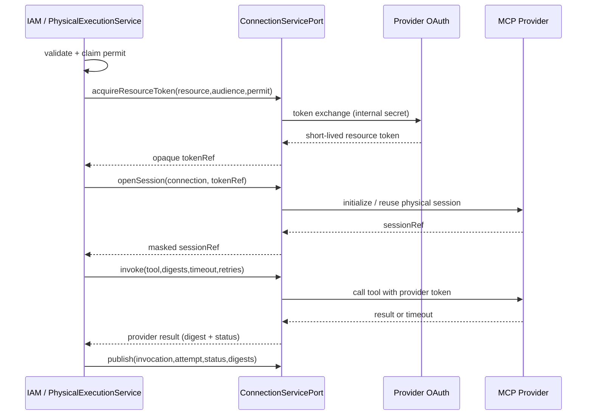

# ConnectionService physical adapter contract

`ConnectionServicePort` is the narrow seam between IAM/authorization orchestration and the independent ConnectionService data plane. The Summer Sample implementation is deliberately in-memory and never performs network I/O; a production adapter can implement the same contract with OAuth token exchange, an MCP transport session and provider calls.

## Contract

1. `acquireResourceToken(ResourceTokenRequest)` exchanges or reuses a short-lived token scoped to the exact MCP resource/audience and permit. Only an opaque `tokenRef` leaves the adapter; raw token material is not returned or logged.
2. `openSession(ConnectionSessionRequest)` creates or reuses a physical MCP session bound to the connection and token reference. The session reference is a masked external identifier.
3. `invoke(McpProviderRequest)` dispatches one tool request with schema/argument digests, timeout and bounded retry count. A timeout is reported as `EXECUTION_UNKNOWN`; callers must reconcile instead of blindly retrying non-idempotent work.
4. `publish(ExecutionStatusReceipt)` emits an idempotent completion/failure receipt keyed by invocation and execution attempt. Receipts contain only masked session/remote references and result digest/status.

The IAM permit is claimed before the adapter is called. The adapter is authenticated as the registered ConnectionService principal and is never allowed to replace `initiator`, `actor`, or `effectiveSubject`.

## Sequence

