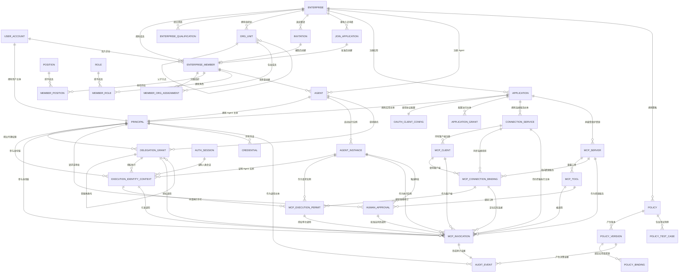
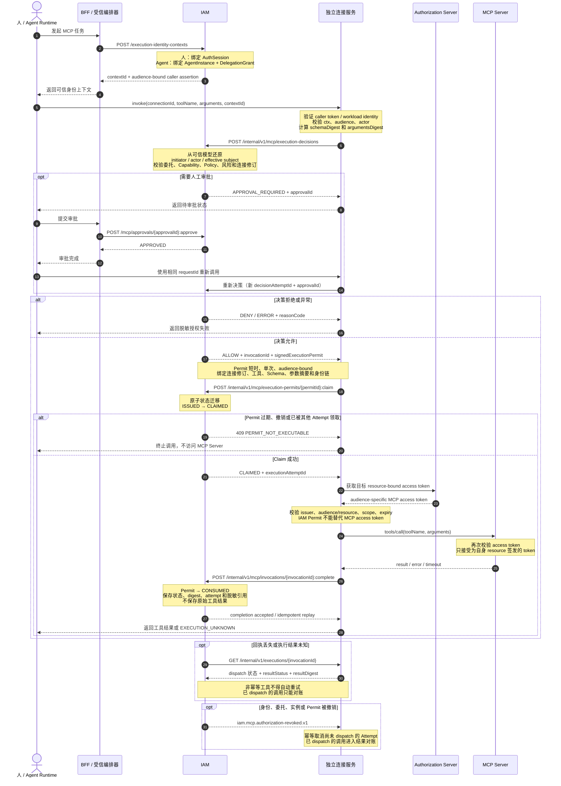

# AICT 统一身份原型技术方案

> 状态说明（2026-09-30）：本文的领域与服务端设计保留为实施参考；独立 `aict-identity` / Vben 前端路径已由 [ADR 0023](../adr/0023-consolidate-identity-frontend-in-summer-ui.md) 替代，身份管理前端统一在 `summer-ui/`。文中旧前端工程步骤不再作为当前实施指令。

## 0. 结论先行

该原型不是一个单纯的 OAuth2 登录页，而是一套企业级 IAM 产品，覆盖：

- 企业注册、企业资料与资质审核；
- 用户账号、企业成员、组织部门、岗位与角色；
- 邀请、入职、调岗、停用、离职；
- Web 应用与 Agent 的机器身份、凭证和访问授权；
- 人和 Agent 通过 MCP 调用工具时的运行实例身份、委托链、审批和逐次调用证据；
- 与独立连接服务之间的资源目录同步、单次执行许可、结果回执和失败对账；
- OIDC/OAuth2 协议配置；
- 授权策略的草稿、发布、暂停、撤销和测试；
- 登录、授权与 Agent 调用审计。

推荐将其建设为独立 IAM 应用或独立仓库，并复用 Summer 4：

- `summer-common`：错误、消息和统一响应；
- `summer-mvc`：管理端 JSON 接口、参数契约、请求关联；
- `summer-data-jpa`：关系模型与复杂查询；
- `summer-security`：OIDC/OAuth2 Authorization Server、Resource Server 和协议适配。

企业、成员、组织、邀请、应用、Agent、策略和审计都是 IAM 产品的业务模型，不应进入 `summer-security` 框架模块。OAuth2/OIDC 标准端点保持原始协议响应，不使用 Unified response；管理端 `/api/v1/**` 使用 Unified response。

## 1. 数据模型与关系

### 1.1 建模原则

1. 内部主键统一使用 `UUID`，DID 是对外稳定身份标识，不直接充当数据库关联键。
2. `UserAccount` 表示自然人的全局登录账号；`EnterpriseMember` 表示该账号在某个企业中的成员身份。一个账号可以加入多个企业。
3. 用户、应用和 Agent 都是可认证、可授权、可持有凭证的主体，因此由统一的 `Principal` 注册表承载公共身份语义。
4. 密码、私钥和 Client Secret 不保存明文；业务库只保存算法、指纹、状态和 KMS/HSM/Vault 引用。
5. 组织、角色、岗位和应用授权均是多对多关系，不在成员主表上堆叠逗号分隔字段。
6. 发布后的策略版本不可修改；修改必须产生新草稿和新版本。
7. 停用、离职、撤销、过期是不同状态，不以一个 `deleted` 布尔值替代业务语义。
8. 所有企业归属数据必须包含 `enterprise_id`，查询层和权限层同时执行租户隔离。
9. MCP 调用不得把“人”、“逻辑 Agent”、“Agent 运行实例”、“MCP 客户端软件”和“被代表的主体”合并成一个字段；每次调用必须可还原完整身份链。
10. OAuth access token 是向 MCP Server 传递授权结果的凭证，不是企业内委托关系的唯一事实来源；委托范围、有效期、再委托和人工审批必须显式建模。
11. 实际 MCP 连接由独立连接服务负责；IAM 不保存连接密钥、refresh token、物理会话或重试状态，只保存连接的安全投影、单次执行许可与审计证据。

### 1.2 核心关系图



### 1.3 数据模型清单

#### A. 企业与资质

| 模型 | 关键字段 | 关系与约束 |
| --- | --- | --- |
| `Enterprise` | `id`, `did`, `name`, `short_name`, `industry`, `scale`, `contact_name`, `contact_mobile`, `address`, `status`, `version` | 企业聚合根；`did` 唯一；状态建议 `PENDING/ACTIVE/SUSPENDED/CLOSED` |
| `EnterpriseQualification` | `enterprise_id`, `license_file_id`, `valid_until`, `representative_type`, `representative_name_cipher`, `representative_id_hash`, `review_status`, `review_reason`, `submitted_at`, `reviewed_at` | 一个企业可有多次资质提交；同一时刻最多一个 `PENDING`；状态 `DRAFT/PENDING/APPROVED/REJECTED/EXPIRED` |
| `EnterpriseAdminAssignment` | `enterprise_id`, `member_id`, `role_id`, `valid_from`, `valid_to` | 不把管理员标志直接放在账号表；支持管理员交接和历史追踪 |

#### B. 统一主体、账号与凭证

| 模型 | 关键字段 | 关系与约束 |
| --- | --- | --- |
| `Principal` | `id`, `principal_type`, `did`, `enterprise_id`, `status`, `created_at` | `principal_type=USER/APPLICATION/AGENT`；DID 全局唯一；用户主体的 `enterprise_id` 可空，应用和 Agent 必须归属企业；MCP Server 作为服务身份时复用其 `Application` 主体，不再引入含义重叠的第四种主体 |
| `UserAccount` | `id`, `principal_id`, `username`, `mobile_cipher`, `mobile_hash`, `email_cipher`, `email_hash`, `account_status`, `last_login_at`, `login_count`, `version` | 与用户 `Principal` 一对一；手机号/邮箱使用密文存储、哈希精确检索；状态 `PENDING/ACTIVE/LOCKED/DISABLED/CLOSED` |
| `Credential` | `id`, `principal_id`, `credential_type`, `key_id`, `algorithm`, `fingerprint`, `secret_ref`, `public_material`, `status`, `issued_at`, `expires_at`, `revoked_at`, `version` | 主体一对多凭证；类型可为 `PASSWORD/PASSKEY/CERTIFICATE/PUBLIC_KEY/CLIENT_SECRET`；`secret_ref` 指向受控密钥设施 |
| `AuthSession` | `id`, `principal_id`, `client_id`, `session_status`, `created_at`, `last_seen_at`, `expires_at`, `revoked_at` | 支撑“停用后已登录会话立即失效”；协议令牌仍由 Authorization Server 的授权存储维护 |

#### C. 成员、组织、岗位与角色

| 模型 | 关键字段 | 关系与约束 |
| --- | --- | --- |
| `EnterpriseMember` | `id`, `enterprise_id`, `user_account_id`, `member_no`, `display_name`, `member_status`, `joined_at`, `left_at`, `version` | `enterprise_id + user_account_id` 唯一；状态 `INVITED/ACTIVE/DISABLED/RESIGNED` |
| `OrgUnit` | `id`, `enterprise_id`, `parent_id`, `unit_type`, `name`, `code`, `leader_member_id`, `description`, `sort_order`, `status`, `version` | 邻接表表达组织树；`unit_type=COMPANY/DEPARTMENT/TEAM`；同级 `code` 唯一；有子节点或有效成员时禁止物理删除 |
| `MemberOrgAssignment` | `member_id`, `org_unit_id`, `is_primary`, `valid_from`, `valid_to` | 成员可兼任多个组织，但同一企业只能有一个主组织 |
| `Position` | `id`, `enterprise_id`, `name`, `code`, `status` | 岗位属于企业，不等同于角色 |
| `MemberPosition` | `member_id`, `position_id`, `org_unit_id`, `valid_from`, `valid_to` | 岗位可以限定到组织节点 |
| `Role` | `id`, `enterprise_id`, `scope`, `name`, `code`, `built_in`, `status` | `scope=SYSTEM/ENTERPRISE`；内置角色至少包含系统管理员、企业管理员、普通成员 |
| `Capability` | `id`, `scope`, `code`, `resource`, `action`, `status` | `code` 全局唯一，采用 `{workspace}.{resource}.{action}`；`scope=SYSTEM/ENTERPRISE`；不等同于 OAuth scope |
| `RoleCapability` | `role_id`, `capability_id` | 角色包含动作级 capability；同一关系唯一，额外允许或拒绝由授权策略处理 |
| `MemberRole` | `member_id`, `role_id`, `valid_from`, `valid_to`, `granted_by` | 支持角色授予、回收和有效期 |

#### D. 邀请与入企申请

| 模型 | 关键字段 | 关系与约束 |
| --- | --- | --- |
| `Invitation` | `id`, `enterprise_id`, `invite_type`, `token_hash`, `target_mobile_hash`, `target_email_hash`, `org_unit_id`, `position_id`, `role_id`, `max_uses`, `used_count`, `expires_at`, `status`, `created_by` | `invite_type=DIRECT/LINK`；只存邀请令牌哈希；接受邀请时原子创建成员和默认关系 |
| `JoinApplication` | `id`, `enterprise_id`, `applicant_account_id`, `source_invitation_id`, `apply_message`, `status`, `reviewed_by`, `review_reason`, `reviewed_at` | 状态 `PENDING/APPROVED/REJECTED/CANCELLED`；同一账号对同一企业只允许一个有效申请 |

#### E. 应用、协议和访问授权

| 模型 | 关键字段 | 关系与约束 |
| --- | --- | --- |
| `Application` | `id`, `enterprise_id`, `principal_id`, `app_code`, `name`, `logo_file_id`, `app_type`, `status`, `version` | `app_type=WEB/NATIVE/SERVICE`；状态 `DRAFT/ACTIVE/MISCONFIGURED/DISABLED` |
| `OAuthClientConfig` | `application_id`, `issuer_uri`, `login_uri`, `redirect_uris`, `post_logout_redirect_uris`, `grant_types`, `response_types`, `scopes`, `client_auth_methods`, `id_token_sign_alg`, `pkce_required`, `refresh_token_rotation`, `version` | 与应用一对一；URI 使用子表或 JSONB 并做逐项校验；生产默认只允许安全协议组合 |
| `ApplicationGrant` | `id`, `application_id`, `subject_type`, `subject_id`, `effect`, `status`, `valid_from`, `valid_to`, `granted_by` | `subject_type=ALL/ORG_UNIT/ROLE/MEMBER`；`effect=ALLOW/DENY`；唯一键防止重复授权 |
| `ApplicationConsent` | `application_id`, `user_account_id`, `scopes`, `granted_at`, `revoked_at` | 对应 OIDC/OAuth2 用户授权同意；可适配 Spring Authorization Server consent 存储 |

#### F. Agent 身份

| 模型 | 关键字段 | 关系与约束 |
| --- | --- | --- |
| `Agent` | `id`, `enterprise_id`, `principal_id`, `agent_code`, `name`, `description`, `owner_member_id`, `runtime_type`, `status`, `version` | Agent 是机器主体，不是应用的一个字符串字段；状态 `DRAFT/ACTIVE/DISABLED/REVOKED` |
| `AgentGrant` | `id`, `agent_id`, `application_id`, `scope`, `resource_pattern`, `status`, `valid_from`, `valid_to` | 限定 Agent 可以调用的应用、scope 和资源；不得只依赖一把无限权限密钥 |
| `AgentCredentialPolicy` | `agent_id`, `max_active_credentials`, `rotation_days`, `ip_allowlist`, `mtls_required` | 约束 Agent 凭证生成、轮换和网络边界 |
| `AgentInstance` | `id`, `agent_id`, `runtime_id`, `workload_identity`, `attestation_type`, `attestation_digest`, `environment`, `status`, `started_at`, `last_seen_at`, `expires_at` | Agent 的短生命运行实例；同一 Agent 可同时有多个实例；必须通过 mTLS、SPIFFE/SVID、云 workload identity 或可验证证明进行认证，不允许自报 `agent_id` |

#### G. MCP 身份、委托与调用证据

MCP 身份链使用以下统一语义：

- `initiator`：引发任务的主体，可以是人或自治 Agent；
- `actor`：实际执行 MCP 调用的主体；Agent 调用时必须继续定位到 `AgentInstance`；
- `effective subject`：本次调用正在行使谁的权限和业务上下文；
- `delegator`：显式向 Agent 授出代理权限的主体；
- `client`：发起 OAuth/MCP 连接的客户端软件，不等同于人或 Agent；
- `transport actor`：实际完成网络连接、OAuth/MCP 协议和工具调用的连接服务应用主体；它不是 `effective subject`；
- `resource server`：接受 audience-bound access token 的 MCP Server；
- `tool`：被请求的精确操作及其输入 Schema。

| 模型 | 关键字段 | 关系与约束 |
| --- | --- | --- |
| `ConnectionService` | `id`, `application_id`, `service_code`, `base_uri`, `permit_audience`, `protocol_version`, `status`, `last_seen_at` | IAM 中对独立连接服务的信任注册；复用 `Application` 的服务主体和凭证；只有 `ACTIVE` 服务可同步目录、申请执行许可和回执结果 |
| `McpClient` | `id`, `enterprise_id`, `connection_service_id`, `external_client_registration_ref`, `authorization_server_issuer`, `client_id`, `client_name`, `client_version`, `redirect_uris`, `auth_method`, `registration_type`, `status` | 连接服务所使用的 MCP OAuth 客户端注册投影；客户端 secret、refresh token 和令牌缓存只存在连接服务的受控密钥设施中 |
| `McpServer` | `id`, `enterprise_id`, `application_id`, `name`, `resource_uri`, `audience`, `authorization_server_issuer`, `metadata_version`, `status` | MCP Server 是 OAuth protected resource/resource server；`resource_uri` 为规范化唯一 URI；内部服务复用所属 `Application` 主体；必须发布 Protected Resource Metadata |
| `McpConnectionBinding` | `id`, `enterprise_id`, `connection_service_id`, `external_connection_id`, `connection_revision`, `mcp_client_id`, `mcp_server_id`, `catalog_digest`, `credential_mode`, `status`, `last_synced_at` | IAM 中的连接安全投影，不是物理会话；`connection_service_id + external_connection_id` 唯一；不保存 endpoint secret、token 或可直接发起连接的凭据 |
| `McpTool` | `id`, `mcp_server_id`, `external_tool_id`, `tool_name`, `schema_digest`, `catalog_revision`, `risk_level`, `required_scope`, `required_capability_code`, `status` | 连接服务对 tool/schema/catalog revision 负责，IAM 对风险、scope、capability 和授权策略负责；执行时必须固定 schema digest 和 catalog revision |
| `DelegationGrant` | `id`, `enterprise_id`, `delegator_principal_id`, `delegate_agent_id`, `parent_grant_id`, `scope_type`, `mcp_server_id`, `tool_patterns`, `resource_patterns`, `capability_codes`, `max_risk_level`, `allow_redelegation`, `max_delegation_depth`, `valid_from`, `expires_at`, `status`, `created_by` | 显式表达“谁允许哪个 Agent 在什么范围内代理”；默认 `allow_redelegation=false`；子委托只能缩减权限和有效期，不得扩权；撤销父委托立即使子链失效 |
| `ExecutionIdentityContext` | `id`, `enterprise_id`, `context_type`, `initiator_principal_id`, `actor_principal_id`, `actor_instance_id`, `effective_subject_principal_id`, `delegation_grant_id`, `auth_session_id`, `caller_authorization_ref`, `source_type`, `source_ref`, `request_digest`, `status`, `created_at`, `expires_at` | 人与 Agent 共用的可信调用身份上下文；人直调时绑定有效 `AuthSession`，Agent 调用时绑定已认证 `AgentInstance` 和必要委托；只能由 IAM、受信网关或编排入口创建，调用方不得自报 initiator/actor/effective subject |
| `McpExecutionPermit` | `id`, `invocation_id`, `enterprise_id`, `connection_service_id`, `connection_binding_id`, `external_connection_id`, `connection_revision`, `execution_context_id`, `actor_principal_id`, `actor_instance_id`, `effective_subject_principal_id`, `delegation_chain_digest`, `tool_id`, `schema_digest`, `arguments_digest`, `permit_jti_hash`, `audience`, `status`, `claimed_execution_attempt_id`, `issued_at`, `expires_at`, `claimed_at`, `consumed_at`, `key_id` | IAM 签发给指定连接服务的短时单次执行许可；绑定 connection revision、tool/schema、参数 digest 和身份链；状态 `ISSUED/CLAIMED/CONSUMED/EXPIRED/REVOKED`；许可本文不落明文 |
| `HumanApproval` | `id`, `enterprise_id`, `requested_by_principal_id`, `agent_instance_id`, `approver_principal_id`, `mcp_server_id`, `tool_id`, `request_digest`, `approval_scope`, `status`, `expires_at`, `approved_at`, `consumed_at` | 高风险调用的一次性或有界审批；审批必须绑定工具、实参 digest、有效期和审批人；参数变化后不得复用 |
| `McpInvocation` | `id`, `enterprise_id`, `request_id`, `trace_id`, `execution_context_id`, `initiator_principal_id`, `actor_principal_id`, `actor_instance_id`, `effective_subject_principal_id`, `transport_principal_id`, `leaf_delegation_grant_id`, `delegation_chain_digest`, `connection_service_id`, `connection_binding_id`, `external_connection_id`, `connection_revision`, `connection_session_ref`, `execution_permit_id`, `execution_attempt_id`, `mcp_client_id`, `mcp_server_id`, `tool_id`, `schema_digest`, `arguments_digest`, `risk_level`, `approval_id`, `decision`, `reason_code`, `result_status`, `result_digest`, `remote_request_ref`, `latency_ms`, `audit_event_id`, `started_at`, `completed_at` | 逐次不可变调用记录；`transport_principal_id` 是连接服务应用主体，不得替换 actor/effective subject；物理会话、远端请求只保存外部脱敏引用，结果正文不进入 IAM |

连接服务与 IAM 的事实来源分工：

| 事实 | 权威服务 |
| --- | --- |
| 连接 endpoint、secret/token、物理会话、健康、重试与超时 | 连接服务 |
| MCP Server/Tool 发现元数据、Schema 与 catalog revision | 连接服务，IAM 保存带修订号的安全投影 |
| 人/Agent 身份、委托、Capability/Policy、风险与人工审批 | IAM |
| 单次调用是否允许、执行许可和身份审计 | IAM |
| 工具实际执行状态与结果 digest | 连接服务产生，IAM 通过幂等回执/事件归档 |

#### H. 策略与审计

| 模型 | 关键字段 | 关系与约束 |
| --- | --- | --- |
| `Policy` | `id`, `enterprise_id`, `name`, `description`, `policy_type`, `lifecycle_status`, `current_version_id`, `version` | 状态 `DRAFT/PUBLISHED/PAUSED/REVOKED`；策略逻辑不直接覆盖已发布版本 |
| `PolicyVersion` | `id`, `policy_id`, `version_no`, `definition_json`, `definition_hash`, `published_by`, `published_at`, `status` | `definition_json` 表达主体、动作、资源、条件、效果和优先级；发布后不可变 |
| `PolicyBinding` | `policy_version_id`, `target_type`, `target_id`, `priority` | 将策略绑定到应用、Agent、资源集合或企业默认范围 |
| `PolicyTestCase` | `id`, `policy_id`, `name`, `input_json`, `expected_decision`, `last_actual_decision`, `last_run_at` | 对应原型的默认测试、用例编辑、ALLOW/DENY/EXCEPTION 结果 |
| `AuditEvent` | `id`, `enterprise_id`, `request_id`, `trace_id`, `event_type`, `actor_principal_id`, `application_id`, `agent_id`, `resource`, `action`, `decision`, `reason_code`, `policy_version_id`, `source_ip`, `latency_ms`, `occurred_at`, `detail_json` | 只追加不修改；`decision=ALLOW/DENY/ERROR`；敏感令牌和密钥不得进入 `detail_json` |

### 1.4 关键状态联动

| 业务动作 | 同一事务内写入 | 事务后联动 |
| --- | --- | --- |
| 企业资质通过 | `EnterpriseQualification=APPROVED`, `Enterprise=ACTIVE` | 发布 `EnterpriseActivated`；允许创建正式应用和 Agent |
| 接受邀请/批准申请 | 创建或复用 `UserAccount`，创建 `EnterpriseMember`、主组织、岗位和角色关系，邀请/申请置为完成 | 发送入企通知；刷新企业成员缓存 |
| 停用成员 | `EnterpriseMember=DISABLED`，结束有效组织/岗位/角色关系 | 撤销该企业上下文下会话和令牌；保留历史审计；Agent 不自动删除，但其所有者关系进入待处理状态 |
| 成员离职 | `EnterpriseMember=RESIGNED`, `left_at` | 撤销企业授权；检查其负责的组织、应用和 Agent 并生成交接任务 |
| 删除组织 | 仅无子节点、无有效成员时允许 | 清理组织树缓存；保留历史 assignment |
| 停用应用 | `Application=DISABLED` | 禁止新授权和令牌签发；撤销有效应用会话；凭证保留但不可使用 |
| 轮换应用/Agent 凭证 | 新建 `Credential=ACTIVE`，旧凭证置 `GRACE` | 到达宽限期后撤销旧凭证；发布凭证轮换事件 |
| Agent 运行实例上线 | 校验 workload identity/证明后创建 `AgentInstance=ACTIVE` | 绑定短期凭证和实例过期时间；证明不可验证时失败关闭 |
| 创建 MCP 委托 | 写入 `DelegationGrant=ACTIVE`，快照授权范围与策略版本 | 刷新委托决策索引；不自动签发超出该范围的 token |
| 启动人/Agent 调用上下文 | 由受信入口创建 `ExecutionIdentityContext=ACTIVE`，绑定 initiator、actor、effective subject、会话/实例、委托和请求 digest | 向调用方下发不可篡改的上下文引用；上下文过期/撤销后不允许继续调用 |
| 连接目录同步 | 按 `connection_revision` 幂等 upsert `McpConnectionBinding`、`McpServer`、`McpTool` 安全投影 | 风险/capability 配置不被发现元数据覆盖；Schema/catalog 变更使旧执行许可失效 |
| 撤销 MCP 委托 | `DelegationGrant=REVOKED`，未消费 `McpExecutionPermit=REVOKED` | 递归使子委托和未消费审批失效；向连接服务发布撤销事件，由其终止可复用物理会话/token |
| 发起 MCP 高风险调用 | 创建 `HumanApproval=PENDING`，绑定 tool 与 request digest | 通知合格审批人；批准、拒绝或过期都写审计 |
| 允许 MCP 工具执行 | 同一事务创建 `McpInvocation=AUTHORIZED`、`McpExecutionPermit=ISSUED`，必要时消费审批 | 返回绑定连接修订、tool/schema、参数 digest 和身份链的短时签名许可 |
| 连接服务执行完成 | 幂等更新 `McpExecutionPermit=CONSUMED`、`McpInvocation.result_status`、外部 session/attempt 脱敏引用 | 追加 `AuditEvent`；回执丢失由对账任务修复，不重复执行工具 |
| 发布策略 | 新建不可变 `PolicyVersion`，更新 `current_version_id` | 原子刷新策略缓存；记录发布审计 |
| 授权决策 | 不修改策略；生成决策结果 | 通过 outbox/消息流追加 `AuditEvent`，失败重试但不泄露请求凭据 |

## 2. 接口与数据模型联动

### 2.1 接口分层

| 接口层 | 路径 | 响应语义 | 主要模型 |
| --- | --- | --- | --- |
| OIDC/OAuth2 协议接口 | `/.well-known/**`, `/oauth2/**`, `/userinfo`, `/connect/logout` | 严格遵循标准，不包装 Unified response | `OAuthClientConfig`, `Credential`, `ApplicationConsent`, Authorization Server 授权存储 |
| IAM 管理接口 | `/api/v1/**` | 使用 Unified response 和 Summer Framework error | 本方案所有业务模型 |
| 内部授权决策接口 | `/internal/v1/authorization/**` | 面向网关/资源服务；低延迟、版本化、失败关闭 | `PolicyVersion`, `PolicyBinding`, `ApplicationGrant`, `AgentGrant` |
| MCP 资源发现与物理连接 | 连接服务调用 MCP Server 的 `/.well-known/oauth-protected-resource`、Authorization Server 发现端点和 MCP endpoint | 由连接服务直接遵循 MCP/OAuth 协议；IAM 不代理数据流 | 连接服务的连接、凭证、会话与发现模型 |
| IAM—连接服务信任与目录接口 | `/internal/v1/connection-services/**` | mTLS/服务主体认证、幂等修订同步、不传输 secret/token | `ConnectionService`, `McpConnectionBinding`, `McpClient`, `McpServer`, `McpTool` |
| MCP 执行决策与回执接口 | `/internal/v1/mcp/execution-*`, `/internal/v1/mcp/invocations/**` | 返回单次短时签名许可；结果回执幂等；失败关闭 | `ExecutionIdentityContext`, `McpExecutionPermit`, `HumanApproval`, `McpInvocation` |
| 审计采集接口 | `/internal/v1/audit-events` 或消息流 | 幂等追加；禁止更新和删除 | `AuditEvent` |

### 2.2 重点接口联动矩阵

| 接口/命令 | 读取模型 | 写入模型 | 核心规则 |
| --- | --- | --- | --- |
| `POST /api/v1/enterprise-registrations` | 注册校验、验证码 | `Principal`, `UserAccount`, `Enterprise`, `EnterpriseMember`, `MemberRole`, `EnterpriseQualification` | 全部成功或全部回滚；首个成员成为企业管理员；企业初始为 `PENDING` |
| `POST /api/v1/invitations/{token}:accept` | `Invitation`, `UserAccount` | `Invitation`, `EnterpriseMember`, `MemberOrgAssignment`, `MemberPosition`, `MemberRole` | 校验 token 哈希、有效期、次数和目标账号；幂等接受 |
| `POST /api/v1/join-applications/{id}:approve` | `JoinApplication`, `UserAccount` | `JoinApplication`, `EnterpriseMember` 及默认关系 | 审批人必须有企业成员管理权限；防止重复入企 |
| `POST /api/v1/enterprises/{id}/members` | `Enterprise`, `OrgUnit`, `Position`, `Role`, `UserAccount` | `EnterpriseMember` 及三类关系 | 手机号/邮箱匹配已有账号时复用账号，不重复建用户主体 |
| `POST /api/v1/enterprises/{id}/members/{memberId}:disable` | `EnterpriseMember`, 有效关系、会话 | `EnterpriseMember`, 关系有效期 | 事务后撤销企业上下文会话；不删除账号和历史审计 |
| `POST /api/v1/enterprises/{id}/members/{memberId}:resign` | 成员、负责资源 | 成员、关系、交接任务 | 有未交接组织/应用/Agent 时拒绝或要求提供接任人 |
| `POST /api/v1/enterprises/{id}/org-units` | 父节点 | `OrgUnit` | 父节点必须属于同一企业；同级编码唯一；限制最大深度 |
| `DELETE /api/v1/enterprises/{id}/org-units/{unitId}` | 子节点、有效成员关系 | `OrgUnit` 状态 | 有子节点或成员时返回冲突，不级联删除成员 |
| `POST /api/v1/enterprises/{id}/applications` | 企业状态 | `Principal`, `Application`, 默认 `OAuthClientConfig`, 初始 `Credential` | 只有激活企业可创建；应用 DID 和凭证在同一工作流生成 |
| `PUT /api/v1/enterprises/{id}/applications/{appId}/oauth-config` | `Application`, 当前配置 | `OAuthClientConfig` | 校验 redirect URI、grant/response/client-auth 组合；配置非法时应用标记 `MISCONFIGURED` |
| `PUT /api/v1/enterprises/{id}/applications/{appId}/grants` | 组织、角色、成员 | `ApplicationGrant` | 授权主体必须属于同一企业；`DENY` 优先于同级 `ALLOW` |
| `POST /api/v1/enterprises/{id}/applications/{appId}/credentials:rotate` | `Application`, 当前凭证 | `Credential` | 私钥/secret 只返回一次；旧凭证进入宽限期，不直接覆盖 |
| `POST /api/v1/enterprises/{id}/agents` | 企业、负责人、可用应用 | `Principal`, `Agent`, `AgentGrant`, 初始 `Credential` | Agent 必须有负责人和最小调用范围；凭证不直接写入 Agent 表 |
| `POST /api/v1/enterprises/{id}/agents/{agentId}/credentials:rotate` | `Agent`, 凭证策略 | `Credential` | 遵守最大有效凭证数、轮换周期、mTLS/IP 约束 |
| `POST /internal/v1/agent-instances` | `Agent`, `AgentCredentialPolicy`, workload identity/attestation | `AgentInstance` | 实例必须由可验证的工作负载身份派生；自报 Agent ID 不构成认证 |
| `POST /api/v1/enterprises/{id}/agents/{agentId}/delegations` | 委托人有效权限、`AgentGrant`, MCP Server/Tool 目录 | `DelegationGrant` | 委托范围必须是委托人权限与 Agent 固有授权的交集；默认不允许再委托 |
| `POST /internal/v1/execution-identity-contexts` | 已认证人类会话、Agent workload identity、调度/工作流授权或父 Agent 委托 | `ExecutionIdentityContext` | initiator/actor/effective subject 必须由受信入口派生，不采信调用请求体中自报的身份 |
| `PUT /internal/v1/connection-services/{serviceId}/connections/{connectionId}/catalog` | 连接服务的已认证服务主体、连接修订和工具发现结果 | `McpConnectionBinding`, `McpClient`, `McpServer`, `McpTool` 投影 | 修订号只能前进；不接受 secret/token；不覆盖 IAM 风险与 capability 配置 |
| `POST /internal/v1/mcp/execution-decisions` | `ExecutionIdentityContext`, `AgentInstance`, `McpConnectionBinding`, `McpTool`, grants/policy/approval | `McpInvocation`, `McpExecutionPermit` | 从可信上下文还原身份并求权限交集；ALLOW 时只向当前连接服务签发单次许可 |
| `POST /internal/v1/mcp/execution-permits/{permitId}:claim` | 连接服务主体、`McpExecutionPermit`, attempt ID、连接修订 | `McpExecutionPermit=CLAIMED`, `McpInvocation.execution_attempt_id` | 原子单领；同一 attempt 幂等，不同 attempt 冲突；claim 失败不得 dispatch |
| `POST /internal/v1/mcp/invocations/{invocationId}:complete` | 连接服务主体、permit jti、execution attempt 及结果 digest | `McpExecutionPermit`, `McpInvocation`, outbox | 回执幂等；只能回执自身受众 permit；不上传敏感工具结果 |
| `POST /internal/v1/mcp/approvals` | 调用上下文、`McpTool.risk_level`, 实参 digest | `HumanApproval` | 只对确定的 tool+参数+主体链发起审批；不允许“批准该 Agent 今后的所有高风险操作” |
| `POST /api/v1/mcp/approvals/{approvalId}:approve` | `HumanApproval`, 审批人 capability 与重新认证状态 | `HumanApproval=APPROVED` | 申请已过期、实参 digest 变化或审批人无权时拒绝 |
| `GET /api/v1/enterprises/{id}/mcp-invocations/{invocationId}` | `McpInvocation`, 委托链、审批、`AuditEvent` | 无 | 返回可脱敏的完整身份链和决策理由；不返回 token 或工具敏感实参 |
| `POST /api/v1/enterprises/{id}/policies/{policyId}:publish` | 草稿、测试用例、绑定目标 | `PolicyVersion`, `Policy`, `PolicyBinding`, outbox | 发布前静态校验和测试必须通过；版本不可变 |
| `POST /internal/v1/authorization/evaluate` | 当前 `PolicyVersion`, bindings, grants, subject context | outbox | 返回 `ALLOW/DENY`、原因码和策略版本；超时或不确定时失败关闭 |
| `GET /api/v1/enterprises/{id}/audit-events` | 审计索引和归档 | 无 | 按时间、主体、应用、Agent、决策、requestId 查询；不返回敏感字段 |

### 2.3 MCP 主要身份与授权逻辑

#### 场景 A：人直接使用 MCP 工具

```text
initiator = 人的 Principal
actor = 人的 Principal
actorInstance = null
effectiveSubject = 人的 Principal
executionContext = 从有效 AuthSession 派生的 ExecutionIdentityContext
transportActor = 连接服务 Application Principal
client = 连接服务持有的 McpClient
resourceServer = McpServer
```

OAuth 授权页显示的是“哪个 MCP Client 请求访问哪个 MCP Server”，最终权限由用户有效 capability/policy、token scope 与工具策略取交集。

#### 场景 B：人指令 Agent 调用 MCP

```text
initiator = 人的 Principal
actor = Agent 的 Principal
actorInstance = 已认证 AgentInstance
effectiveSubject = 委托人的 Principal
delegation = 有效 DelegationGrant
executionContext = 受信入口创建的 ExecutionIdentityContext
transportActor = 连接服务 Application Principal
client = 连接服务持有的 McpClient
```

有效权限不继承“人的全部权限”，而是：

```text
EffectivePermission =
  EffectiveSubjectPermission
  ∩ AgentGrant
  ∩ DelegationGrant
  ∩ TokenScopeAndAudience
  ∩ McpToolCapabilityAndPolicy
  ∩ HumanApprovalScope(if required)
```

#### 场景 C：企业自治 Agent 或定时任务

Agent 可以使用自身 `Principal` 作为 `initiator` 和 `effectiveSubject`，但必须使用持久化的 `AgentGrant`/任务授权，不得在没有活跃人类会话时默认冒用所有者身份。`owner_member_id` 用于责任归属和审计，不等同于所有者的权限自动授予 Agent。

无论人直接调用、Agent 交互、定时还是工作流任务，都先由受信入口创建 `ExecutionIdentityContext`。调用方只持有上下文引用，不能通过伪造 `initiator_principal_id`、`actor_principal_id` 或 `effective_subject_principal_id` 改变身份链。

#### 场景 D：Agent 再委托子 Agent

每一跳必须创建指向父授权的 `DelegationGrant`，且同时满足：父授权允许再委托、深度未超限、工具/资源/能力/有效期只缩减不扩大。`McpInvocation` 必须保存叶子授权、完整链 digest 以及每一跳的可审计引用。

#### 运行时决策

```text
DECISION_ALLOW =
  initiator/effective subject active
  AND actor Agent active (when actor is Agent)
  AND AgentInstance authenticated and attested (when actor is Agent)
  AND AuthSession/token authorization revision current (when actor is Human)
  AND ExecutionIdentityContext trusted, active and request-bound
  AND ConnectionService authenticated, active and selected for this connection
  AND McpConnectionBinding active and revision/schema digests match
  AND McpClient active
  AND McpServer active
  AND expected authorization issuer/resource/scope configuration is trusted
  AND AgentGrant covers the operation (when actor is Agent)
  AND DelegationGrant chain active, unexpired and non-escalating (when acting for another subject)
  AND Capability/Policy permits the tool and resource
  AND matching, unexpired HumanApproval exists (when risk policy requires it)

EXECUTE =
  DECISION_ALLOW
  AND McpExecutionPermit signature, audience, nonce, expiry and request digests match
  AND McpExecutionPermit atomically claimed by the selected ConnectionService
  AND actual MCP access token issuer, audience/resource, expiry and scope are valid
```

任意一项缺失、不确定或超时都返回 `DENY/ERROR`，不降级为“只看 token 是否有效”。

#### access token 中的身份投影

MCP 规范定义 OAuth 传输与 audience 约束，但不定义企业 Agent 委托 claims。AICT 自有 Authorization Server 签发的内部 token 建议使用以下投影，并以服务端模型为权威事实来源：

| Claim | 语义 |
| --- | --- |
| `sub` | `effective subject`；人直接调用时是用户 Principal，Agent 使用自身权限时是 Agent Principal |
| `act.sub` | 实际 actor 的 Principal；Agent 代表人/其他主体时必须存在，可采用 RFC 8693 `act` claim 语义 |
| `client_id`/`azp` | 连接服务使用的 `McpClient`，是 OAuth 技术客户端，不是业务 actor |
| `aud` | 目标 `McpServer.resource_uri/audience`，必须与 authorization/token request 的 `resource` 一致 |
| `scope` | OAuth 协议委托边界，不替代 Capability/Policy/DelegationGrant |
| `enterprise_id` | 显式企业上下文；MCP Server 必须与自身资源所属租户交叉校验 |
| `agent_instance_id` | Agent 调用时的短生命运行实例；只对内部受信 token 发行 |
| `delegation_id` | 当前叶子 `DelegationGrant`；完整链在服务端还原，不将过大或敏感的委托链全量放入 token |
| `jti`, `iat`, `exp` | token 唯一标识、签发和过期时间；由连接服务在受控 token vault 中管理，IAM 不保存 token 明文 |

`owner_member_id`、负责人或任务创建人不得自动写入 `sub`；只有存在有效委托时，Agent 才能以另一主体作为 `effective subject`。

### 2.4 IAM 与连接服务交互设计

#### 2.4.1 调用时序



IAM 不位于工具数据面：工具参数和结果由调用方与连接服务传输，IAM 默认只接收规范化 digest、风险所需的最小字段和脱敏结果元数据。

`executionContextId` 不能作为裸引用单独使用。受信入口必须同时向调用方签发短时、audience 为目标连接服务的 caller assertion/access token，并包含不可篡改的 `ctx` 引用；连接服务校验签名、audience、调用凭据与 `ctx` 一致后，才可向 IAM 请求执行决策。

#### 2.4.2 目录同步接口（连接服务 → IAM）

`PUT /internal/v1/connection-services/{serviceId}/connections/{connectionId}/catalog`

关键请求字段：

```json
{
  "enterpriseId": "ent_xxx",
  "connectionRevision": 12,
  "catalogDigest": "sha256:...",
  "mcpServer": {
    "resourceUri": "https://mcp.example.com",
    "audience": "https://mcp.example.com",
    "authorizationServerIssuer": "https://auth.example.com"
  },
  "clientRegistrationRef": "client-ref-001",
  "tools": [
    {
      "externalToolId": "tool-001",
      "name": "create_order",
      "schemaDigest": "sha256:..."
    }
  ]
}
```

规则：

- 连接服务通过 mTLS 或 `private_key_jwt` 认证，`serviceId` 必须与认证主体绑定；
- `connectionRevision` 只能前进，相同 revision+digest 为幂等重放，相同 revision 不同 digest 返回冲突；
- payload 中禁止出现 client secret、refresh token、证书私钥和 endpoint 认证头；
- 工具删除采用新 catalog 修订中的缺席/显式 `REMOVED`，IAM 将投影置为不可执行而不物理删除审计引用；
- IAM 的 `risk_level`、`required_capability_code` 和 Policy 不被目录同步覆盖。

#### 2.4.3 单次执行决策（连接服务 → IAM）

`POST /internal/v1/mcp/execution-decisions`

```json
{
  "requestId": "req_xxx",
  "decisionAttemptId": "decision_001",
  "executionContextId": "ctx_xxx",
  "callerAuthorizationRef": "authz_xxx",
  "actorInstanceId": "instance_xxx",
  "connectionId": "conn_xxx",
  "connectionRevision": 12,
  "toolName": "create_order",
  "schemaDigest": "sha256:...",
  "argumentsDigest": "sha256:...",
  "approvalId": null
}
```

`actorInstanceId` 仅 Agent 调用时存在；人直调时为 `null`。`callerAuthorizationRef` 是 IAM 可验证/撤销的非密钥授权引用（例如 token `jti` 或授权上下文 ID），不得替代原始调用凭据验证。连接服务只上送 IAM 已签发且已向本服务受众绑定的 `executionContextId`，以及从已验证 workload identity 解析的实例引用；initiator、actor、effective subject、delegation 和 enterprise 一律由 IAM 从 `ExecutionIdentityContext`、`AuthSession`/`AgentInstance` 与连接投影中还原。请求体中不允许出现可覆盖这些身份的字段。

决策响应只有四类：

| decision | 语义 |
| --- | --- |
| `ALLOW` | 返回 `invocationId`、`permitId`、短时签名 `executionPermit` 和过期时间 |
| `APPROVAL_REQUIRED` | 返回 `approvalId`，连接服务不得发起物理调用 |
| `DENY` | 身份、委托、scope/capability/policy 或工具风险不允许 |
| `ERROR` | IAM 不能得出可信决策；连接服务必须失败关闭 |

#### 2.4.4 执行许可契约（IAM → 连接服务）

`executionPermit` 是签名 JWT/PASETO 或等价不可篡改制品，不是 MCP Server access token。最小 claims：

| Claim | 约束 |
| --- | --- |
| `iss`, `aud` | issuer 为 IAM，audience 精确绑定 `ConnectionService.permit_audience` |
| `jti`, `iat`, `exp` | 单次 nonce，建议有效期 30–60 秒 |
| `invocation_id`, `permit_id` | 绑定 IAM 中的调用与许可记录 |
| `connection_binding_id`, `external_connection_id`, `connection_revision` | 同时绑定 IAM 安全投影、连接服务物理连接标识和修订，防止配置变更或映射替换后继续执行 |
| `tool_id`, `schema_digest`, `arguments_digest` | 绑定工具、Schema 和规范化实参 |
| `execution_context_id`, `actor_instance_id` | 绑定可信身份上下文；人直调时实例为空，Agent 调用时必须等于已认证运行实例 |
| `sub`, `act.sub` | 审计用 effective subject 与业务 actor；不改变连接服务自身的 transport principal |
| `cnf` | 可选绑定连接服务 mTLS 证书或持有密钥，降低许可被窃后的可用性 |

连接服务必须先验证签名、audience、过期时间、`cnf`、身份上下文、连接映射/修订和全部 digest，再调用 `POST /internal/v1/mcp/execution-permits/{permitId}:claim` 原子将状态从 `ISSUED` 切换到 `CLAIMED`。未成功 claim 时不得调用 MCP Server。`CONSUMED` 表示这份执行权已完成结算，不表示工具一定成功；明确失败和结果未知同样会消费该许可，避免再次执行。

claim 请求至少携带：

```json
{
  "permitJti": "jti_xxx",
  "executionAttemptId": "attempt_001",
  "connectionRevision": 12,
  "workerIdentity": "cs-node-07"
}
```

IAM 以 `permitId + permitJti + executionAttemptId` 做原子幂等：同一 attempt 重放返回既有 `CLAIMED`；不同 attempt 领取同一 permit 返回 `409 IAM_MCP_PERMIT_ALREADY_CLAIMED`。claim 成功只代表准许本 attempt 发送一次，不代表远端工具已执行。

#### 2.4.5 工具执行与结果回执

物理调用由连接服务自身完成：

1. 从 token vault 取得或换取专用于 `McpServer.resource_uri` 的 access token；
2. 创建或复用物理 MCP session，但必须重新校验 token audience 和当前撤销版本；
3. 使用被 permit 绑定的 tool/schema/arguments 执行；
4. 对超时区分“未发送”、“已发送未知结果”和“已明确失败”，不对非幂等工具自动重试；
5. 调用 `POST /internal/v1/mcp/invocations/{invocationId}:complete` 或发布等价的 `McpInvocationCompleted/Failed/Unknown` 事件。

回执示例：

```json
{
  "permitId": "permit_xxx",
  "permitJti": "jti_xxx",
  "executionAttemptId": "attempt_001",
  "connectionSessionRef": "session_hash_xxx",
  "resultStatus": "SUCCEEDED",
  "resultDigest": "sha256:...",
  "remoteRequestId": "remote_req_xxx",
  "latencyMs": 231,
  "occurredAt": "2026-08-26T09:30:00Z"
}
```

`resultStatus` 至少支持 `SUCCEEDED/FAILED_PRE_DISPATCH/FAILED/EXECUTION_UNKNOWN/CANCELLED`。不默认上传工具结果正文；`connectionSessionRef`、`remoteRequestId` 必须脱敏且不能反推出凭据。

#### 2.4.6 失败恢复与对账

- 根 `requestId` 在调用方、连接服务和 IAM 三方保持不变；`Idempotency-Key` 按子操作确定性派生（例如 `invoke/decision-1/claim/complete`），同一子操作重放不得产生第二次副作用；
- permit claim 后连接服务崩溃时，IAM 将调用保持为 `EXECUTION_UNKNOWN`，不自动重发；
- IAM 定时按 `invocationId` 调用连接服务的 `GET /internal/v1/executions/{invocationId}` 对账，或消费其可重放事件流；
- 连接服务必须保留至少覆盖 IAM 对账窗口的 execution attempt 索引，但凭据和工具结果按自身更严格保留策略处理。
- IAM 撤销上下文、AgentInstance、委托、连接服务信任或未消费 permit 时，发布 `iam.mcp.authorization-revoked.v1`；连接服务按事件版本幂等消费，取消尚未 dispatch 的 attempt。已经 dispatch 的调用不能宣称已撤回，只能等待结果或标记 `EXECUTION_UNKNOWN`。

#### 2.4.7 通用契约、错误和重试

所有 IAM—连接服务请求必须携带 `Authorization`（或 mTLS 绑定身份）、`X-Request-Id`、W3C `traceparent` 和协议版本头；所有有状态 POST/PUT 必须携带 `Idempotency-Key`。

| 情况 | HTTP/业务语义 | 重试策略 |
| --- | --- | --- |
| 服务主体无效 | `401/403` | 不重试，触发信任/凭据告警 |
| 目录 revision 冲突 | `409 IAM_MCP_CATALOG_REVISION_CONFLICT` | 先读取当前修订，不盲目覆盖 |
| Schema/catalog 已变更 | `409 IAM_MCP_CATALOG_CHANGED` | 重新发现工具、重新计算 digest 和申请决策 |
| 需要审批 | HTTP `200` + `APPROVAL_REQUIRED` | 审批通过后保持根 `requestId`，使用新 `decisionAttemptId`/子操作幂等键重新决策，不复用旧 permit |
| permit 过期/撤销 | `409 IAM_MCP_PERMIT_NOT_EXECUTABLE` | 如工具尚未发送，可使用同一幂等键重新申请决策 |
| permit 已被其他 attempt claim | `409 IAM_MCP_PERMIT_ALREADY_CLAIMED` | 查询现有 attempt，不创建新工具调用 |
| IAM 超时/不可用 | `ERROR`/超时 | 决策和 claim 均失败关闭；同一幂等键有限重试 |
| completion 回执超时 | 连接服务保存 outbox | 可无限幂等重放至成功/进入死信告警，不重新执行工具 |

### 2.5 事务、事件与缓存边界

- 同一聚合内使用本地数据库事务；跨模块联动通过 transactional outbox。
- 企业激活、成员入企/停用/离职、应用停用、凭证轮换、策略发布必须产生领域事件。
- 组织树、应用授权、当前策略版本可缓存；缓存键必须包含 `enterprise_id` 和版本号。
- 管理控制台的 Session Snapshot 与 Capability Set 只允许短时内存缓存，不得持久化到浏览器存储；响应通过 `ETag` 或等价的服务端版本暴露会话/授权修订号，支持条件重验证。
- 前端在窗口重新聚焦、工作区或 Enterprise Context 导航时重验证相关快照；任一请求返回 `401/403` 时立即使对应 Session Snapshot 与 Capability Set 失效。缓存新鲜度不能替代资源服务逐请求授权与撤销检查。
- 策略发布采用“数据库提交后原子切换版本指针”，运行时只读取已发布版本。
- 凭证明文只在创建/轮换响应中出现一次，响应体禁止进入应用日志、审计详情和 APM body capture。
- 所有管理控制台写请求必须携带 `Idempotency-Key`；服务端按主体与操作保存请求摘要及结果，同一请求的安全重试返回原结果，不得重复产生领域副作用。
- 修改或删除已有 IAM 资源必须携带基于当前资源 `ETag` 的 `If-Match`；版本过期返回 `412 Precondition Failed`，禁止静默覆盖并发修改。数据库版本字段仍作为服务端乐观锁依据，但不以请求体 `version` 替代 HTTP 条件写契约。
- 角色、capability、策略、成员状态、凭证、会话等授权相关写操作不得在管理控制台中乐观显示成功；前端等待服务端确认后再失效相关详情、列表、Session Snapshot 与 Capability Set。低风险且可逆的纯展示操作需要单独批准才可使用乐观更新。
- 批量导入和导出使用异步任务模型，避免长事务和大响应占用管理接口线程。
- MCP 授权决策、`McpInvocation` 预记录和 `McpExecutionPermit` 签发在同一事务中生成；permit claim 使用原子条件更新，工具执行结果以幂等回执/事件归档。
- 委托、审批、连接投影和执行许可缓存键必须包含 `enterprise_id`、主体/实例 ID、connection revision、MCP Server audience 与策略版本；撤销事件必须优先于普通缓存 TTL 生效。

## 3. 接口清单与数据模型

### 3.1 认证、会话与协议接口

| 方法与路径 | 用途 | 关联模型 |
| --- | --- | --- |
| `GET /.well-known/openid-configuration` | OIDC 元数据 | `OAuthClientConfig`, issuer 配置 |
| `GET /.well-known/oauth-protected-resource` | MCP Server 发布 OAuth Protected Resource Metadata，暴露 resource URI 和可用 Authorization Server | `McpServer` |
| `GET /oauth2/jwks` | 签名公钥集 | Authorization Server JWK/KMS adapter |
| `GET/POST /oauth2/authorize` | 授权码/OIDC 登录 | `Application`, `OAuthClientConfig`, `AuthSession`, `ApplicationConsent` |
| `POST /oauth2/token` | 令牌签发、刷新、Client Credentials | `Application`, `Credential`, Authorization Server 授权存储 |
| `POST /oauth2/revoke` | 撤销 token | Authorization Server 授权存储 |
| `POST /oauth2/introspect` | token 检查 | Authorization Server 授权存储 |
| `GET /userinfo` | OIDC 用户信息 | `UserAccount`, `EnterpriseMember`, scopes |
| `GET/POST /connect/logout` | 单点登出 | `AuthSession`, Authorization Server 授权存储 |
| `GET /api/v1/session` | 获取管理控制台 Session Snapshot，不返回 OAuth token 或菜单结构；返回 `ETag` 或等价会话版本以支持条件重验证 | `UserAccount`, `EnterpriseMember`, `AuthSession` |
| `DELETE /api/v1/session` | 销毁 Product Session，并协调 OIDC 登出与本地会话撤销 | `AuthSession`, Authorization Server 授权存储 |
| `GET /api/v1/platform/capabilities` | 获取平台运营工作区的有效 Capability Set；返回 `ETag` 或等价授权版本以支持条件重验证 | `Role`, `Capability`, `RoleCapability`, published policies |
| `GET /api/v1/enterprises/{enterpriseId}/capabilities` | 获取指定 Enterprise Context 的有效 Capability Set；返回 `ETag` 或等价授权版本以支持条件重验证 | `EnterpriseMember`, `MemberRole`, `RoleCapability`, published policies |
| `POST /api/v1/password-recovery/challenges` | 发起找回密码 | `UserAccount`, verification challenge |
| `POST /api/v1/password-recovery:complete` | 完成密码重置 | `Credential`, `AuthSession` |

生产协议基线：

- Web 应用使用 Authorization Code + PKCE；
- 连接服务作为 HTTP MCP Client，必须使用 Protected Resource Metadata 发现 Authorization Server，并在 authorization/token request 中传入规范化 `resource` 参数；
- 连接服务执行 MCP Authorization Code flow 时必须使用 PKCE，并在发起授权前验证 Authorization Server metadata 明确支持 PKCE；
- 机器调用使用 Client Credentials、mTLS 或 `private_key_jwt`；
- 允许 Refresh Token 时必须轮换并检测重放；
- 原型中出现的 Password Grant、Implicit Grant 和 HS256 只视为原型配置项，生产默认禁用；
- Redirect URI 必须精确匹配；生产环境默认拒绝非 localhost 的 HTTP URI。

### 3.2 企业与资质接口

| 方法与路径 | 用途 | 关联模型 |
| --- | --- | --- |
| `POST /api/v1/enterprise-registrations` | 企业注册 | `Enterprise`, `UserAccount`, `EnterpriseMember`, `EnterpriseQualification` |
| `POST /api/v1/personal-registrations` | 个人账号注册 | `Principal`, `UserAccount`, `Credential` |
| `GET /api/v1/enterprises/{enterpriseId}` | 企业资料 | `Enterprise`, 当前资质、企业管理员 |
| `PATCH /api/v1/enterprises/{enterpriseId}` | 编辑企业资料 | `Enterprise` |
| `GET /api/v1/enterprises/{enterpriseId}/qualifications` | 资质历史 | `EnterpriseQualification` |
| `POST /api/v1/enterprises/{enterpriseId}/qualifications` | 上传/更新资质 | `EnterpriseQualification`, file metadata |
| `POST /api/v1/enterprise-qualifications/{id}:approve` | 系统管理员审核通过 | `EnterpriseQualification`, `Enterprise` |
| `POST /api/v1/enterprise-qualifications/{id}:reject` | 审核驳回 | `EnterpriseQualification` |

### 3.3 成员与账号接口

| 方法与路径 | 用途 | 关联模型 |
| --- | --- | --- |
| `GET /api/v1/enterprises/{enterpriseId}/members` | 成员分页、筛选、排序 | `EnterpriseMember`, `UserAccount`, org/position/role read model |
| `POST /api/v1/enterprises/{enterpriseId}/members` | 单个成员入职 | `UserAccount`, `EnterpriseMember`, assignments |
| `GET /api/v1/enterprises/{enterpriseId}/members/{memberId}` | 成员详情 | 成员、账号、组织、岗位、角色、凭证摘要 |
| `PATCH /api/v1/enterprises/{enterpriseId}/members/{memberId}` | 修改成员资料 | `EnterpriseMember`, `UserAccount` 可编辑字段 |
| `POST /api/v1/enterprises/{enterpriseId}/members/{memberId}:enable` | 启用成员 | `EnterpriseMember` |
| `POST /api/v1/enterprises/{enterpriseId}/members/{memberId}:disable` | 停用成员 | `EnterpriseMember`, assignments, sessions |
| `POST /api/v1/enterprises/{enterpriseId}/members/{memberId}:resign` | 离职 | `EnterpriseMember`, assignments, handover task |
| `POST /api/v1/enterprises/{enterpriseId}/members:import` | 批量导入 | `ImportJob`, 成员及关系 |
| `GET /api/v1/enterprises/{enterpriseId}/members:export` | 导出成员 | 成员 read model, `ExportJob` |
| `GET /api/v1/users/{userId}/credentials` | 用户凭证摘要 | `Credential` |
| `POST /api/v1/users/{userId}/credentials:rotate` | 用户凭证轮换 | `Credential`, sessions |
| `POST /api/v1/users/{userId}/credentials/{credentialId}:revoke` | 撤销凭证 | `Credential`, sessions |

### 3.4 组织、岗位与角色接口

| 方法与路径 | 用途 | 关联模型 |
| --- | --- | --- |
| `GET /api/v1/enterprises/{enterpriseId}/org-tree` | 获取组织树 | `OrgUnit` |
| `POST /api/v1/enterprises/{enterpriseId}/org-units` | 新建组织/部门 | `OrgUnit` |
| `PATCH /api/v1/enterprises/{enterpriseId}/org-units/{unitId}` | 编辑、移动、设置负责人 | `OrgUnit` |
| `DELETE /api/v1/enterprises/{enterpriseId}/org-units/{unitId}` | 删除空组织 | `OrgUnit`, assignments |
| `GET /api/v1/enterprises/{enterpriseId}/org-units/{unitId}/members` | 组织成员列表 | `MemberOrgAssignment`, member read model |
| `PUT /api/v1/enterprises/{enterpriseId}/members/{memberId}/org-assignments` | 调岗/兼任 | `MemberOrgAssignment` |
| `GET /api/v1/enterprises/{enterpriseId}/positions` | 岗位列表 | `Position` |
| `POST /api/v1/enterprises/{enterpriseId}/positions` | 新建岗位 | `Position` |
| `PUT /api/v1/enterprises/{enterpriseId}/members/{memberId}/positions` | 分配岗位 | `MemberPosition` |
| `GET /api/v1/enterprises/{enterpriseId}/roles` | 角色列表 | `Role` |
| `POST /api/v1/enterprises/{enterpriseId}/roles` | 新建企业角色 | `Role` |
| `PUT /api/v1/enterprises/{enterpriseId}/roles/{roleId}/capabilities` | 配置角色能力集合 | `Role`, `Capability`, `RoleCapability` |
| `PUT /api/v1/enterprises/{enterpriseId}/members/{memberId}/roles` | 分配角色 | `MemberRole` |

### 3.5 邀请与申请接口

| 方法与路径 | 用途 | 关联模型 |
| --- | --- | --- |
| `GET /api/v1/enterprises/{enterpriseId}/invitations` | 邀请记录 | `Invitation` |
| `POST /api/v1/enterprises/{enterpriseId}/invitations` | 定向邀请 | `Invitation` |
| `POST /api/v1/enterprises/{enterpriseId}/invitation-links` | 生成邀请链接 | `Invitation` |
| `POST /api/v1/invitations/{token}:accept` | 接受邀请 | `Invitation`, member and assignments |
| `POST /api/v1/invitations/{invitationId}:revoke` | 撤销邀请 | `Invitation` |
| `GET /api/v1/enterprises/{enterpriseId}/join-applications` | 入企申请列表 | `JoinApplication`, applicant read model |
| `POST /api/v1/enterprises/{enterpriseId}/join-applications` | 发起入企申请 | `JoinApplication` |
| `POST /api/v1/join-applications/{id}:approve` | 通过申请 | `JoinApplication`, `EnterpriseMember` |
| `POST /api/v1/join-applications/{id}:reject` | 拒绝申请 | `JoinApplication` |

### 3.6 应用与凭证接口

| 方法与路径 | 用途 | 关联模型 |
| --- | --- | --- |
| `GET /api/v1/enterprises/{enterpriseId}/applications` | 应用列表和连接状态 | `Application`, config/credential summary |
| `POST /api/v1/enterprises/{enterpriseId}/applications` | 创建应用 | `Principal`, `Application`, `OAuthClientConfig`, `Credential` |
| `GET /api/v1/enterprises/{enterpriseId}/applications/{appId}` | 应用详情 | 应用、配置、授权、凭证摘要 |
| `PATCH /api/v1/enterprises/{enterpriseId}/applications/{appId}` | 修改应用基本信息 | `Application` |
| `POST /api/v1/enterprises/{enterpriseId}/applications/{appId}:enable` | 启用应用 | `Application` |
| `POST /api/v1/enterprises/{enterpriseId}/applications/{appId}:disable` | 停用应用 | `Application`, sessions |
| `GET /api/v1/enterprises/{enterpriseId}/applications/{appId}/oauth-config` | 协议配置 | `OAuthClientConfig` |
| `PUT /api/v1/enterprises/{enterpriseId}/applications/{appId}/oauth-config` | 更新协议配置 | `OAuthClientConfig`, `Application.status` |
| `GET /api/v1/enterprises/{enterpriseId}/applications/{appId}/grants` | 访问授权 | `ApplicationGrant` |
| `PUT /api/v1/enterprises/{enterpriseId}/applications/{appId}/grants` | 批量替换授权 | `ApplicationGrant` |
| `GET /api/v1/enterprises/{enterpriseId}/applications/{appId}/credentials` | 凭证摘要 | `Credential` |
| `POST /api/v1/enterprises/{enterpriseId}/applications/{appId}/credentials:rotate` | 轮换凭证 | `Credential` |
| `POST /api/v1/enterprises/{enterpriseId}/applications/{appId}/credentials/{credentialId}:revoke` | 撤销凭证 | `Credential` |

### 3.7 Agent 接口

| 方法与路径 | 用途 | 关联模型 |
| --- | --- | --- |
| `GET /api/v1/enterprises/{enterpriseId}/agents` | Agent 列表 | `Agent`, owner, credential/grant summary |
| `POST /api/v1/enterprises/{enterpriseId}/agents` | 创建 Agent | `Principal`, `Agent`, `AgentGrant`, `Credential` |
| `GET /api/v1/enterprises/{enterpriseId}/agents/{agentId}` | Agent 详情 | Agent、负责人、授权、凭证策略 |
| `PATCH /api/v1/enterprises/{enterpriseId}/agents/{agentId}` | 修改 Agent | `Agent` |
| `POST /api/v1/enterprises/{enterpriseId}/agents/{agentId}:enable` | 启用 Agent | `Agent` |
| `POST /api/v1/enterprises/{enterpriseId}/agents/{agentId}:disable` | 停用 Agent | `Agent` |
| `PUT /api/v1/enterprises/{enterpriseId}/agents/{agentId}/grants` | 配置调用范围 | `AgentGrant` |
| `GET /api/v1/enterprises/{enterpriseId}/agents/{agentId}/credentials` | Agent 凭证摘要 | `Credential` |
| `POST /api/v1/enterprises/{enterpriseId}/agents/{agentId}/credentials:rotate` | 生成/轮换凭证 | `Credential`, `AgentCredentialPolicy` |
| `POST /api/v1/enterprises/{enterpriseId}/agents/{agentId}/credentials/{credentialId}:revoke` | 撤销凭证 | `Credential` |

### 3.8 MCP 身份、委托与调用接口

IAM 提供的接口：

| 方法与路径 | 用途 | 关联模型 |
| --- | --- | --- |
| `GET /api/v1/platform/connection-services` | 查询受信连接服务 | `ConnectionService`, `Application` |
| `POST /api/v1/platform/connection-services` | 注册连接服务应用主体、permit audience 和协议版本 | `ConnectionService`, `Application`, `Credential` |
| `PATCH /api/v1/platform/connection-services/{serviceId}` | 启停连接服务信任或更新协议版本 | `ConnectionService`, outstanding permits |
| `PUT /internal/v1/connection-services/{serviceId}/connections/{connectionId}/catalog` | 幂等同步连接、Server 和 Tool 安全投影 | `McpConnectionBinding`, `McpClient`, `McpServer`, `McpTool` |
| `GET /api/v1/enterprises/{enterpriseId}/mcp-connections` | 查询连接安全投影和同步修订 | `McpConnectionBinding`, server/client summary |
| `GET /api/v1/enterprises/{enterpriseId}/mcp-connections/{bindingId}` | 查看连接投影、目录 digest 和同步状态 | `McpConnectionBinding`, `McpServer`, `McpClient` |
| `GET /api/v1/enterprises/{enterpriseId}/mcp-connections/{bindingId}/tools` | 查询工具 Schema 修订、风险和所需能力 | `McpTool` |
| `PATCH /api/v1/enterprises/{enterpriseId}/mcp-tools/{toolId}/security-policy` | 设置风险级别、scope、capability 和审批策略 | `McpTool`, policy binding |
| `GET /api/v1/enterprises/{enterpriseId}/agents/{agentId}/instances` | 查询 Agent 当前和历史运行实例 | `AgentInstance` |
| `POST /internal/v1/agent-instances` | 使用 workload identity/attestation 注册短生命实例 | `Agent`, `AgentInstance`, `AgentCredentialPolicy` |
| `POST /internal/v1/agent-instances/{instanceId}:heartbeat` | 刷新实例健康和有效期 | `AgentInstance` |
| `POST /api/v1/enterprises/{enterpriseId}/agent-instances/{instanceId}:revoke` | 管理员撤销运行实例 | `AgentInstance`, outstanding `McpExecutionPermit` |
| `POST /internal/v1/execution-identity-contexts` | 从已认证人类会话、Agent workload identity、调度/工作流授权或父 Agent 委托创建可信身份上下文 | `ExecutionIdentityContext`, `AuthSession`, `AgentInstance`, `DelegationGrant` |
| `POST /api/v1/enterprises/{enterpriseId}/agents/{agentId}/delegations` | 创建人/主体到 Agent 的委托授权 | `DelegationGrant`, `AgentGrant`, `McpServer`, `McpTool` |
| `GET /api/v1/enterprises/{enterpriseId}/agents/{agentId}/delegations` | 查询 Agent 收到的委托及链路 | `DelegationGrant` |
| `POST /api/v1/enterprises/{enterpriseId}/delegations/{delegationId}:revoke` | 撤销委托及依赖的子委托/执行许可 | `DelegationGrant`, `McpExecutionPermit`, `HumanApproval` |
| `POST /internal/v1/mcp/execution-decisions` | 对单次 tool call 进行身份链和权限交集判定 | `McpInvocation`, `McpExecutionPermit`, `McpTool`, grants, policy, approval |
| `POST /internal/v1/mcp/execution-permits/{permitId}:claim` | 连接服务在物理调用前原子领取单次许可 | `McpExecutionPermit` |
| `POST /internal/v1/mcp/invocations/{invocationId}:complete` | 幂等回执成功、失败或结果未知 | `McpInvocation`, `McpExecutionPermit`, `AuditEvent` |
| `POST /internal/v1/mcp/approvals` | 发起高风险调用审批 | `HumanApproval`, `McpInvocation` context |
| `POST /api/v1/mcp/approvals/{approvalId}:approve` | 有权人员批准指定调用 | `HumanApproval`, approver capability/session |
| `POST /api/v1/mcp/approvals/{approvalId}:reject` | 拒绝指定调用 | `HumanApproval` |
| `GET /api/v1/enterprises/{enterpriseId}/mcp-invocations` | 按人、Agent、实例、Server、Tool、决策查询调用 | `McpInvocation`, `AuditEvent` |
| `GET /api/v1/enterprises/{enterpriseId}/mcp-invocations/{invocationId}` | 查看脱敏身份链、委托、审批和决策证据 | `McpInvocation`, `DelegationGrant`, `HumanApproval`, `AuditEvent` |

连接服务自身必须提供给 Agent runtime/对账流程的接口：

| 方法与路径 | 用途 | 约束 |
| --- | --- | --- |
| `POST /internal/v1/connections/{connectionId}/tools/{toolName}:invoke` | 接收工具调用、请求 IAM 决策并执行 MCP | 验证人类 caller token 或 Agent workload identity；校验 audience-bound `ctx`；必须将同一 `requestId` 和派生的 `Idempotency-Key` 传给 IAM |
| `GET /internal/v1/executions/{invocationId}` | IAM 对账未完成/结果未知调用 | 只允许 IAM 受信主体访问；返回 `executionAttemptId`、dispatch 状态、结果状态/digest、远端请求引用和发生时间，不返回原始凭据/结果 |
| 订阅 `iam.mcp.authorization-revoked.v1` | 接收上下文、实例、委托、服务信任和 permit 撤销 | 按 `eventId + revocationVersion` 幂等；只取消未 dispatch attempt，已 dispatch 调用进入结果对账 |
| `POST /api/v1/enterprises/{enterpriseId}/connections` 及配套 CRUD/test/rotate | 管理连接、凭据、健康检查和轮换 | 由连接服务拥有；接入 IAM 作为 Resource Server 执行 capability/policy 授权 |

### 3.9 策略与审计接口

| 方法与路径 | 用途 | 关联模型 |
| --- | --- | --- |
| `GET /api/v1/enterprises/{enterpriseId}/policies` | 策略列表 | `Policy`, current version summary |
| `POST /api/v1/enterprises/{enterpriseId}/policies` | 创建策略草稿 | `Policy`, draft `PolicyVersion` |
| `GET /api/v1/enterprises/{enterpriseId}/policies/{policyId}` | 策略详情 | `Policy`, versions, bindings, tests |
| `PATCH /api/v1/enterprises/{enterpriseId}/policies/{policyId}/draft` | 编辑草稿 | draft `PolicyVersion` |
| `POST /api/v1/enterprises/{enterpriseId}/policies/{policyId}:copy` | 复制为新策略/草稿 | `Policy`, `PolicyVersion` |
| `POST /api/v1/enterprises/{enterpriseId}/policies/{policyId}:publish` | 发布策略 | immutable `PolicyVersion`, bindings, outbox |
| `POST /api/v1/enterprises/{enterpriseId}/policies/{policyId}:pause` | 暂停策略 | `Policy` |
| `POST /api/v1/enterprises/{enterpriseId}/policies/{policyId}:revoke` | 撤销策略 | `Policy` |
| `GET /api/v1/enterprises/{enterpriseId}/policies/{policyId}/test-cases` | 测试用例 | `PolicyTestCase` |
| `POST /api/v1/enterprises/{enterpriseId}/policies/{policyId}/test-cases` | 新建测试用例 | `PolicyTestCase` |
| `POST /api/v1/enterprises/{enterpriseId}/policies/{policyId}:test` | 执行默认或批量测试 | `PolicyVersion`, `PolicyTestCase` |
| `POST /internal/v1/authorization/evaluate` | 运行时授权决策 | policy/grant read model, outbox |
| `GET /api/v1/enterprises/{enterpriseId}/audit-events` | 审计查询 | `AuditEvent` |
| `GET /api/v1/enterprises/{enterpriseId}/audit-events/{eventId}` | 审计详情 | `AuditEvent`, policy/version summary |
| `POST /internal/v1/audit-events` | 内部幂等采集 | `AuditEvent` |

## 4. 模块和技术架构

### 4.1 推荐模块

| 模块 | 对外 Interface | 隐藏的复杂度 |
| --- | --- | --- |
| `TenantDirectory` | 注册、查询、更新企业和资质 | 企业状态机、资质审核、管理员交接、租户隔离 |
| `IdentityDirectory` | 注册账号、成员入企、停用/离职、查询主体 | 账号去重、DID、凭证、会话撤销、成员关系 |
| `OrganizationDirectory` | 组织树 CRUD、调岗、岗位和角色分配 | 树约束、负责人、有效期、多对多关系 |
| `InvitationWorkflow` | 创建、接受、审批、拒绝邀请/申请 | token 安全、幂等、过期、原子入企 |
| `ClientRegistry` | 应用、OIDC/OAuth2 配置、访问授权、凭证轮换 | 协议组合校验、客户端持久化、密钥生命周期 |
| `AgentRegistry` | Agent 注册、运行实例登记、授权、凭证轮换 | 逻辑机器主体与短生命工作负载身份分离、attestation、负责人交接、mTLS/IP 约束 |
| `ConnectionServiceTrust` | 注册/停用连接服务、验证服务主体、协议版本和 permit audience | mTLS/private_key_jwt 信任、密钥轮换、服务停用与未消费 permit 撤销 |
| `McpRegistry` | 接收连接目录修订，维护 Client/Server/Tool 安全投影 | 修订幂等、resource URI/audience 规范化、Schema digest、发现字段与 IAM 风险/capability 字段分权 |
| `DelegationAuthority` | 创建/撤销委托、派生可信 ExecutionIdentityContext、再委托、高风险审批 | 权限衰减、发起人来源信任、有效期、链深度、父授权撤销传导、request digest 绑定和审批消费 |
| `McpRuntimeAuthorization` | 逐次 evaluate、签发/claim 执行许可、幂等回执和形成 Invocation 证据 | 主体—实例—委托链绑定、连接修订/Schema TOCTOU 防护、权限交集、单次 permit 和失败关闭 |
| `AuthorizationPolicy` | 草稿、发布、测试、运行时 evaluate | 版本不可变、优先级、缓存切换、决策解释 |
| `AuditLedger` | 追加审计、分页查询、归档 | 幂等、脱敏、冷热分层、不可篡改校验 |

控制器和协议适配器只跨这些 Interface，不直接拼接多个 Repository。模块内部可以有 Repository、KMS、消息、缓存 adapter，但不暴露给调用方。

### 4.2 部署建议

首期采用模块化单体，而不是立即拆成多个微服务：

- 一个 IAM 管理应用；
- 一个 Authorization Server 运行单元，可先与管理应用同进程、独立过滤链，后续按容量拆分；
- 一个独立连接服务运行单元，作为受信 `Application/Principal`，负责连接配置、凭据/token vault、OAuth/MCP 握手、会话池、工具发现、执行、超时与重试；
- PostgreSQL 保存业务与协议持久化数据；
- Redis 保存短期验证码、登录挑战、会话索引、策略热缓存和限流状态；
- IAM KMS/HSM/Vault 保存身份、签名和管理凭据；连接服务使用独立 token vault/KMS 保存连接 secret、refresh token 和客户端凭据，两者不共用明文密钥存储；
- 对象存储保存营业执照、Logo 等文件；
- transactional outbox + 消息总线处理会话撤销、缓存刷新、通知和审计落库；
- 审计量上升后再将查询副本投递到 ClickHouse/OpenSearch，PostgreSQL 仍保存权威事件索引和 outbox 状态。

### 4.3 Spring/Summer 落点

- 管理接口：Spring MVC + Summer MVC Parameter contract + Bean Validation。
- 持久化：Spring Data JPA；复杂成员、组织和审计查询使用 Summer SQL template read model。
- OAuth2/OIDC：Spring Authorization Server，通过持久化 `RegisteredClientRepository`、authorization、consent 和 JWK adapter 替换示例内存实现。
- 资源保护：Summer Security Resource Server；scope 和企业上下文共同参与授权。
- MCP 协议适配：由连接服务对接每个 HTTP MCP Server 的 Protected Resource Metadata、Authorization Server discovery、PKCE/客户端认证、RFC 8707 `resource`/audience 校验和物理会话；IAM 只提供身份与执行授权。
- 工作负载身份：`AgentInstance` 优先接入 SPIFFE/SPIRE、云厂商 workload identity 或 Kubernetes ServiceAccount 联合身份；IAM 只保存可验证标识、attestation digest 和短期绑定。
- 连接服务换票：连接服务根据单次 permit 和目标 `resource` 取得 audience-specific token；对 AICT 自有 Authorization Server 可选 RFC 8693 Token Exchange/OBO，对外部 Authorization Server 使用其支持的授权流，但永远不透传 Agent 调用连接服务的入站 token。
- 错误协议：管理接口使用 `SUMMER_*` 框架错误承载协议级失败，IAM 业务错误使用独立命名空间，例如 `IAM_MEMBER_DISABLED`、`IAM_INVITATION_EXPIRED`、`IAM_POLICY_TEST_FAILED`。
- 请求关联：所有管理、协议和内部接口透传 `requestId`；审计事件保存 `request_id` 和 `trace_id`。

## 5. 一致性、安全与非功能要求

### 5.1 数据一致性

- 所有租户操作都从 URL 中显式取得 `enterpriseId`，逐请求校验当前主体在该企业中的有效成员关系与权限；不得依赖服务端会话中的可变“当前企业”。
- `EnterpriseMember`、`Application`、`Agent`、`Policy` 使用乐观锁版本字段。
- 组织调岗、角色回收、成员停用和策略发布必须幂等。
- 对外 ID、DID、邀请码和凭证 ID 使用不可预测值；邀请码只保存哈希。
- 数据库唯一约束必须覆盖账号手机号/邮箱哈希、DID、企业内应用编码、组织同级编码和策略版本号。
- MCP 相关唯一约束至少覆盖 `ConnectionService.service_code`、`connection_service_id + external_connection_id`、`enterprise_id + McpServer.resource_uri`、`authorization_server_issuer + McpClient.client_id`、`mcp_server_id + external_tool_id`、`agent_id + AgentInstance.runtime_id`、`enterprise_id + McpInvocation.request_id` 和 `McpExecutionPermit.permit_jti_hash`。
- 连接目录修订使用乐观顺序约束：低于当前 revision 的同步忽略，相同 revision 不同 digest 拒绝，新 revision 与还在 `ISSUED` 的旧 permit 撤销在同一事务/事件边界内完成。

### 5.2 安全基线

- 管理员操作强制 MFA；高风险动作支持二次确认和重新认证。
- 企业资料、手机号、邮箱、法人信息分级加密；列表接口默认脱敏。
- Client Secret/Agent Secret 只展示一次；私钥原则上永不离开 KMS/HSM。
- 凭证轮换采用双凭证宽限期，撤销后立即加入本地和分布式拒绝索引。
- Agent 逻辑身份不得共享一把长期密钥给所有运行实例；每个 `AgentInstance` 使用短期、可撤销、可定位到工作负载的凭证或证明。
- 调用方上送的 initiator、actor、effective subject、delegation 和 enterprise 字段不得作为授权事实；IAM 只从服务端 `ExecutionIdentityContext` 及其 `AuthSession`/`AgentInstance` 绑定还原身份，不存在可信上下文时不得执行。
- 连接服务必须作为独立 `Application/Principal` 使用 mTLS 或 `private_key_jwt` 访问 IAM；不得使用用户、Agent 或 MCP Server 的凭据调用 IAM 内部接口。
- `McpExecutionPermit` 必须短时、单次、audience-bound，并绑定连接修订、Schema digest、参数 digest 和运行实例；建议使用 `cnf` 绑定连接服务持有密钥。
- permit 必须在工具调用前原子 claim；不允许两个连接节点并发使用同一 permit，也不允许把 permit 当作 MCP Server access token。
- IAM—连接服务接口禁止传输 client secret、refresh token、私钥、完整工具结果和非必要敏感参数；使用规范化 digest 做 TOCTOU 校验与审计关联。
- 物理调用超时后如无法确定 MCP Server 是否已执行，结果必须记为 `EXECUTION_UNKNOWN`；除非工具显式声明幂等且使用稳定业务幂等键，否则禁止自动重试。
- MCP Client 必须与操作主体分开审计；“使用某个已注册 Client”不代表“获得该用户或 Agent 权限”。
- MCP Server 必须校验 access token 是为自身 canonical resource/audience 签发，只接受其 Authorization Server 发行且范围充足的 token；不接受、不转发其他资源的 token。
- MCP Client 发起授权前必须从已验证元数据记录预期 issuer，回调时校验 `iss`，防止多 Authorization Server 环境中的 mix-up 攻击。
- MCP access token 只放在 `Authorization: Bearer` 头中，不得放在 URI query、日志、审计详情、APM body capture 或工具参数中。
- MCP Server 调用上游/下游 API 必须使用新的目标资源 token，严禁将 MCP Client 传入的 access token 原样透传，避免 confused deputy 和跨 audience 权限泄露。
- 委托默认不可再委托；允许时必须同时限制深度、有效期、工具、资源、capability 和风险级别，并证明每一跳权限只衰减不放大。
- 高风险工具必须使用绑定 request digest 的人工审批；批准后任一主体、工具、资源或参数变化都要重新评估。
- BFF Product Session Cookie 使用 `HttpOnly`、`Secure` 与适配 OIDC 跳转的 `SameSite` 策略；独立 CSRF Cookie 由前端请求适配器复制到请求头，所有 `POST/PUT/PATCH/DELETE`（包括退出登录）必须校验 CSRF token，并结合 Origin 校验。
- 审计详情不记录密码、token、验证码、secret、私钥、完整身份证号或完整手机号。
- 管理端 UI 只消费动作级 Capability Code；角色名称与 OAuth scope 不作为路由、按钮或操作权限判断依据。
- `ALLOW` 和 `DENY` 之外必须有 `ERROR`；授权服务异常时默认失败关闭。
- 策略运行时返回可稳定聚合的 `reason_code`，详细解释只对有权限的管理员可见。

### 5.3 性能目标建议

| 场景 | 初期目标 |
| --- | --- |
| 运行时授权决策 | 缓存命中 P95 < 20 ms，P99 < 50 ms |
| MCP 单次身份链与委托判定 | 缓存命中 P95 < 30 ms，不含工具执行；审批等待不占用同步请求线程 |
| IAM—连接服务执行决策 | 决策+签发 permit P95 < 50 ms；permit claim P95 < 20 ms；不包含 OAuth 换票和 MCP 工具执行 |
| OIDC token endpoint | P95 < 150 ms，不含外部 IdP |
| 管理列表查询 | P95 < 500 ms，默认分页 20，最大 100 |
| 成员批量导入 | 异步任务，单批建议不超过 10 万行 |
| 审计查询 | 热数据 30 天；大范围查询异步导出 |

### 5.4 管理控制台测试接缝与门禁

- 单元测试覆盖 Summer 响应 envelope、结构化错误映射、query key、Capability 判定、缓存失效和 CSRF/幂等/条件写请求头生成。
- Vue 组件与垂直 Module 集成测试以 BFF HTTP 边界为接缝，覆盖加载、空状态、校验错误、`401/403`、`412`、重试和提交状态，不以纯快照测试代替行为断言。
- Playwright E2E 连接真实的同源测试 BFF/Summer 环境，至少覆盖 OIDC 登录与 Session Snapshot 启动、平台/企业工作区隔离、显式 Enterprise Context、Capability 路由和动作控制、CSRF、幂等重试、并发冲突及退出登录。
- IAM—连接服务消费者契约测试必须覆盖：目录 revision 冲突、Schema digest 变更、ALLOW/DENY/APPROVAL_REQUIRED/ERROR、permit audience/过期/并发 claim、completion 幂等重放、`EXECUTION_UNKNOWN` 对账和 secret/token 不进入 payload/日志。
- 普通前端 PR 必须通过格式化与 lint、TypeScript、单元/组件测试、BFF 契约测试、`aict-identity` 产品子应用生产构建和关键 Playwright 冒烟流程。
- Vben 上游集成分支除产品门禁外，还必须通过共享 packages 全量测试和 playground E2E。
- 初期不设置全仓统一覆盖率百分比；认证、租户隔离、授权、凭证和并发边界必须以明确场景测试作为强制门禁。

## 6. 原型确认范围与技术推导

### 6.1 已从原型目视确认

- 企业注册、个人注册、找回密码和多组登录/认证状态页面；
- 企业信息编辑、营业执照/资质有效期、法人或授权代表、审核状态；
- 成员筛选、导入导出、入职、停用、删除/离职、凭证管理；
- 组织树、新建部门、上级部门、部门编码、部门负责人、调岗和离职；
- 普通邀请、邀请链接、申请列表、批准和拒绝；
- 应用列表、应用 DID、连接/配置异常状态、认证地址、登录/登出回调、发起登录 URL；
- OIDC/OAuth2 grant、response type、签名算法、client authentication 配置；
- 按所有人、组织、角色、成员配置应用访问授权；
- 应用身份凭证、指纹、有效期和轮换入口；
- Agent 列表、创建、凭证生成和凭证查看；
- 审计搜索、预览、ALLOW、DENY、EXCEPTION 详情；
- 策略列表、分步向导、草稿编辑、复制、发布、暂停、撤销和测试用例。

### 6.2 技术方案中的合理推导

- `Principal` 统一主体注册表、通用 `Credential`、outbox、KMS/HSM、审计冷热分层不是页面字段，而是为保证一致性、安全性和可演进性引入的技术模型。
- `AgentInstance`、`ExecutionIdentityContext`、`ConnectionService`、`McpClient`、`McpServer`、`McpConnectionBinding`、`McpTool`、`DelegationGrant`、`McpExecutionPermit`、`HumanApproval` 和 `McpInvocation` 不是原型页面中已明确展示的字段；它们是为满足人和 Agent 操作 MCP 时的身份分离、发起人来源信任、连接服务分权、单次执行许可、高风险审批和完整可审计性而增加的技术推导。
- MCP 授权部分已按当前官方 `2026-07-28` 规范核验：MCP Server 作为 OAuth resource server，必须发布 Protected Resource Metadata；连接服务作为 MCP Client，必须使用 `resource` 参数、PKCE 和服务端 audience 校验；Agent 调用连接服务的入站 token 禁止透传给 MCP Server。
- 原型没有提供完整接口契约、错误码、并发策略、数据保留期和密钥设施，本方案给出了建议基线，需在实现前由产品、安全和运维共同确认。
- Figma 连接器当前账号对文件只有查看权限，无法读取节点级设计元数据和原型连线；页面内容通过浏览器公开画布目视核验。因此页面跳转顺序和少数字段名称仍需由原型所有者最终确认。

### 6.3 MCP 授权核验基线

- MCP Authorization（当前版本 `2026-07-28`）：<https://modelcontextprotocol.io/specification/2026-07-28/basic/authorization>
- MCP Authorization Security Considerations：<https://modelcontextprotocol.io/specification/2026-07-28/basic/authorization/security-considerations>
- OAuth Protected Resource Metadata（RFC 9728）：<https://datatracker.ietf.org/doc/html/rfc9728>
- OAuth Resource Indicators（RFC 8707）：<https://www.rfc-editor.org/rfc/rfc8707.html>
- OAuth Token Exchange（RFC 8693，仅作为可选 OBO/下游换票实现）：<https://www.rfc-editor.org/rfc/rfc8693.html>

## 7. 实施顺序

### 7.1 IAM 领域能力实施顺序

1. 第一阶段：企业、账号、成员、组织、邀请；完成租户隔离、DID 和账号去重。
2. 第二阶段：应用注册、持久化 Authorization Server、OIDC/OAuth2 安全基线、应用授权和凭证轮换。
3. 第三阶段：Agent 主体、Agent Grant、AgentInstance、ExecutionIdentityContext、workload identity、mTLS/密钥策略和实例/发起人审计。
4. 第四阶段：连接服务 Application/Principal 信任、MCP Client/Server/Tool 目录同步、`McpConnectionBinding` 和修订幂等。
5. 第五阶段：DelegationGrant、权限衰减、高风险 HumanApproval、单次 `McpExecutionPermit`、McpInvocation 身份链审计、回执对账和 token 不透传。
6. 第六阶段：策略草稿、不可变版本、发布、运行时 evaluate 和测试用例。
7. 第七阶段：审计归档、风险分析、外部 IdP/SCIM、自动化入离职和规模化性能优化。

每个阶段都必须同时交付：数据库迁移、Interface 契约、集成测试、HTTP E2E、权限矩阵测试、审计验证和凭证不泄露检查。

### 7.2 AICT Identity Console 实施顺序

控制台采用 tracer-bullet 顺序，每一步都形成可构建、可测试、可演示的纵向增量：

1. 固定本地与 CI 的 Node `24.16.0`、Corepack `pnpm@11.16.0`，使用 `pnpm install --frozen-lockfile` 建立未改动上游的类型检查、单元测试和生产构建基线。
2. 新建隔离产品子应用 `apps/aict-identity`，建立独立入口、配置、测试、构建与 CI；保留 `apps/web-antd` 及其他上游应用和 Demo 作为示例与平台验证资产。
3. 打通同源 BFF 会话、Session Snapshot、平台运营与企业两个隔离工作区、显式 Enterprise Context 和 Capability Set。
4. 以企业成员目录作为第一个完整纵向切片，交付分页、详情、启用和停用，覆盖读取、条件写、权限校验、缓存失效和审计链路。
5. 交付 Platform Operations 企业审核流程，验证无企业租户上下文的平台治理边界。
6. 按组织、邀请、应用、授权策略、Agent/MCP、审计的顺序扩展垂直 Module；只有出现第二个真实产品消费者时，才将共享能力提升到 `packages/business/*`。

该控制台顺序是前端产品与联调交付顺序，不替代 7.1 的 IAM 领域能力演进顺序；控制台切片依赖的后端契约必须按需先行或同步交付。
