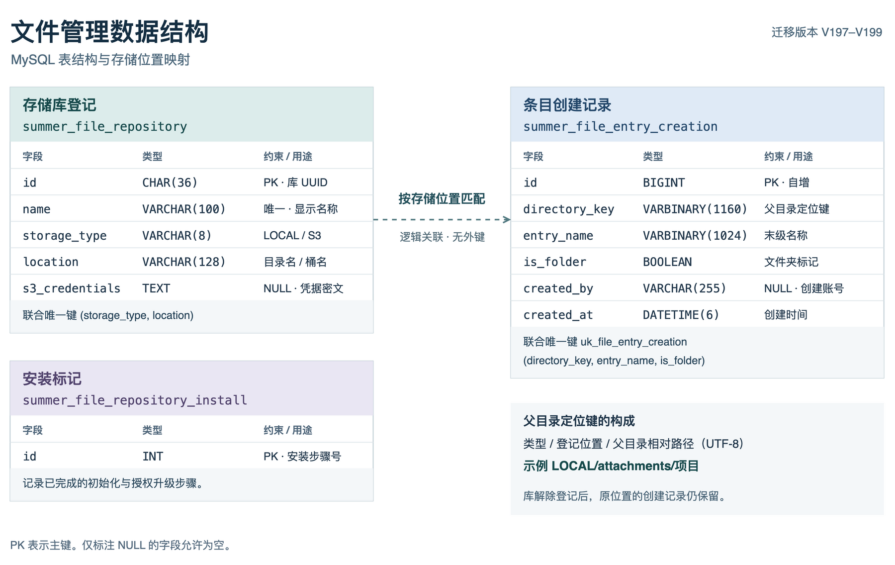

# 平台文件管理技术方案

本文描述截至 2026-11-27 的 Summer Sample 和 Summer UI 实现。一级菜单「文件管理」下有两个入口：「文件存储库」登记存储位置、查看容量和维护 S3 凭据；「文件管理器」在选定的存储库中浏览目录、上传、下载和删除。本文以现行控制器、存储实现和 MySQL 迁移 V197–V199 为准。

## 1. 一个文件如何定位

以本地库 `attachments` 中的 `项目/说明.pdf` 为例，一次目录查询涉及三个标识。

| 标识 | 示例 | 用途 |
| --- | --- | --- |
| 存储库登记 ID | 服务端生成的 UUID | HTTP 路径中的 `{id}`，用于查登记表取得类型和位置 |
| 库内相对路径 | `项目/说明.pdf` | LOCAL 定位到配置根目录下的 `attachments/项目/说明.pdf`；S3 则以登记的桶名和完整对象键定位 |
| 创建记录键 | `(LOCAL/attachments/项目, 说明.pdf, false)` | 按父目录、末级名称、条目类型匹配创建人和创建时间；前两项均用 UTF-8 字节存储 |

文件内容、目录层级、文件大小由底层存储提供。MySQL 保存库登记、条目创建记录及安装标记。服务端列出底层存储中的直接子项，一次查询该父目录的创建记录，在内存按名称和类型合并。这使外部写入或历史遗留的文件也能出现在列表中。

前端两个入口分别调用 `FileRepositoryController` 和 `PlatformFileController`，均通过 `FileStoreManager` 访问业务层。默认实现 `DefaultFileStoreManager` 负责查库、校验、加锁和合并元数据，按登记类型委派给 `LocalFileStorage` 或 `S3FileStorage`。[管理接口](../../summer-sample/src/main/java/com/abluepoint/summer/sample/storage/FileStoreManager.java) · [默认实现](../../summer-sample/src/main/java/com/abluepoint/summer/sample/storage/DefaultFileStoreManager.java)

## 2. HTTP 接口契约

下表的路径共用前缀 `/api/v1/platform`。`{id}` 为小写十六进制 UUID。成功的 JSON 接口返回 HTTP 200，表中结果指统一响应的 `data`。统一响应另含 `success`、`error`、`requestId`、`timestamp`；失败时前端读取 `error.code`、`error.message` 和字段违规明细。下载成功时直接返回文件流。[统一响应](../../summer-common/src/main/java/com/abluepoint/summer/common/response/ApiResponse.java)

### 2.1 文件存储库

| 方法和路径 | 请求 | 成功结果及行为 |
| --- | --- | --- |
| GET `/file-repositories` | 无业务参数 | `Summary[]`，按库名、ID 升序，逐库统计存储状态与容量 |
| POST `/file-repositories` | JSON 必填 `name`、`type`、`path`；S3 可带 `accessKeyId`、`secretAccessKey` | `{id,name,type,path}`。LOCAL 创建或接管指定目录，S3 对已有桶执行 `HeadBucket` 校验 |
| PUT `/file-repositories/{id}/credentials` | JSON 必填 `accessKeyId`、`secretAccessKey` | `{"updated":true}`。仅适用 S3，使用新凭据验证桶访问，验证失败回滚 |
| DELETE `/file-repositories/{id}` | 路径参数 | `{"removed":true}`。解除登记，保留物理内容与条目创建记录 |

`name` 必须非空白，最长 100 字符。`type` 取 `LOCAL` 或 `S3`。`path` 是本地根目录下的单级目录名或 S3 桶名。通用位置格式为 `[a-zA-Z0-9][a-zA-Z0-9._-]{0,127}`；S3 另外要求 3–63 位、小写字母或数字开头结尾，中间允许小写字母、数字、点和连字符，禁止连续两个点。S3 凭据一旦传入就须成对提供，长度上限分别为 256 和 512。管理页面新增 S3 库要求填写二者；接口兼容省略两项并使用 SDK 默认凭据链的登记。返回 DTO 均不含密钥。[登记控制器](../../summer-sample/src/main/java/com/abluepoint/summer/sample/authorization/api/permission/FileRepositoryController.java) · [字段 Style](../../summer-sample/src/main/java/com/abluepoint/summer/sample/validation/RequestFieldStyles.java) · [管理页面](../../summer-ui/src/pages/platform/file-repositories/index.tsx)

`Summary` 含 `id,name,type,path,state,blobCount,totalSize,availableSpace`。这里的 `path` 是用于展示的本地绝对路径或 `s3://桶名`；登记响应中的 `path` 则是登记时的位置名。在线状态为 `ONLINE`，数量和总字节数统计库内文件，排除 S3 目录标记；LOCAL 另报所在文件系统的可用字节数，S3 的 `availableSpace` 为 null。统计失败时该库以 `OFFLINE` 返回，三个数值均为空。

### 2.2 文件与目录

| 方法和路径 | 请求 | 成功结果及行为 |
| --- | --- | --- |
| GET `/files` | 无业务参数 | `[{id,name}]`，供选择器使用，按库名、ID 排序，无需扫描库容量 |
| GET `/files/{id}/entries` | 查询参数 `folder` 可省略 | `Entry[]`，仅含该目录直接子项，目录在前，同类按名称升序；空目录返回空数组 |
| POST `/files/{id}/folders` | 查询参数 `name` 必填、`folder` 可省略 | `{"created":true}`，在父目录下新建一个空文件夹 |
| POST `/files/{id}/upload` | 查询参数 `folder` 可省略；`multipart/form-data`，单个必填 part 名为 `file` | `{"uploaded":true}`，取原始文件名写入指定目录，同名冲突拒绝覆盖 |
| GET `/files/{id}/download` | 查询参数 `key` 必填，含文件名的完整库内路径 | `application/octet-stream` 二进制流，`Content-Disposition: attachment` 携带以 UTF-8 编码的末级文件名 |
| DELETE `/files/{id}/entries` | 查询参数 `key` 必填 | `{"deleted":true}`。`key=项目/说明.pdf` 删除文件，`key=项目/` 仅删除空文件夹；根目录不能删除 |

省略 `folder` 表示根目录。传参时按查询参数编码完整值，保留解码后名称中的空格、中文和 `#`。新建名称和上传文件名必须是单个路径段；对象相对路径最多 1024 个 UTF-8 字节，各段须非空白，禁止 `.`、`..`、反斜杠、冒号、控制字符和以 `.upload-` 开头的段。新建文件夹还须为 `/x` 留足长度。删除接口先识别末尾的 `/`，再校验目录键。[文件控制器](../../summer-sample/src/main/java/com/abluepoint/summer/sample/authorization/api/permission/PlatformFileController.java)

例如，查询 `attachments` 库中的「项目」目录时，请求路径为 `GET /api/v1/platform/files/{id}/entries?folder=%E9%A1%B9%E7%9B%AE`。下面是其 `data` 示例。

```json
[
  {"name":"归档","folder":true,"size":0,"createdBy":"operator","createdAt":"2026-11-27T01:30:00Z"},
  {"name":"说明.pdf","folder":false,"size":2048,"createdBy":"operator","createdAt":"2026-11-27T01:35:00Z"}
]
```

`size` 对文件表示字节数。目录在 LOCAL 返回文件系统属性值，在 S3 返回 0，页面统一显示「—」。`createdBy` 是创建时认证账号，`createdAt` 是服务端时间；缺少历史记录时两项均无值，页面显示「未记录」。

### 2.3 权限与错误

平台托管模式初装时，存储库 GET 关联 `file-repositories-view`，写接口关联 `file-repositories-manage`；文件 GET（含下载）关联 `files-view`，创建、上传、删除关联 `files-manage`。两个导航入口分别关联 `file-repositories-menu`、`files-menu`。控制器按平台域校验读写权限，页面按具体接口操作授权显示按钮；目录与文件共用删除授权。库 ID 用于定位登记记录，三张文件模块表中均无按用户、库或目录划分的 ACL 字段。[安装与资源绑定](../../summer-sample/src/main/java/com/abluepoint/summer/sample/authorization/infrastructure/permission/PlatformDirectoryInstallation.java) · [按钮与接口映射](../../summer-sample/src/main/java/com/abluepoint/summer/sample/authorization/application/permission/InterfaceOperationService.java)

| HTTP 状态 | 典型触发条件 |
| --- | --- |
| 400 | 字段或路径不合法、对 LOCAL 提交 S3 凭据、密钥未成对提供 |
| 403 | 当前账号缺少目标管理接口授权 |
| 404 | 库未登记、读取的文件或列举的目录不存在、待删除的空目录不存在 |
| 409 | 库名或存储位置重复、同目录名称冲突、待删除文件夹含文件或子目录 |
| 413 | 上传超过服务端接收限制；应用默认单文件 64 MB、请求整体 65 MB |
| 503 | 存储位置无法访问、登记或更换凭据时无法验证桶、文件操作出现其他存储 I/O 错误 |

删除普通文件按底层的“如存在则删除”语义执行，目标文件已缺失时仍可能返回成功。批量上传由浏览器逐文件发起独立请求，逐项显示等待、上传中、成功或失败，单项失败后继续处理后续文件；网络无响应时提示刷新目录核对，并在有请求 ID 时展示编号。[上传配置](../../summer-sample/src/main/resources/application.yml) · [上传与错误处理](../../summer-ui/src/pages/platform/files/Folder.tsx)

## 3. MySQL 表结构与关联

V197 建立登记表和安装标记表，V198 为登记表增加 S3 凭据列，V199 建立创建记录表。已在本地开发库只读核对这三次迁移的成功记录，以及下列字段、主键和唯一索引。[V197](../../summer-sample/src/main/resources/db/migration/mysql/V197__file_repositories.sql) · [V198](../../summer-sample/src/main/resources/db/migration/mysql/V198__file_repository_s3_credentials.sql) · [V199](../../summer-sample/src/main/resources/db/migration/mysql/V199__file_entry_creation.sql)



[打开可编辑的 draw.io 源图](../diagrams/platform-file-management/file-data-model.drawio)

### 3.1 存储库登记表 `summer_file_repository`

| 字段 | MySQL 类型 | 可空 | 用途与约束 |
| --- | --- | --- | --- |
| `id` | CHAR(36) | 否 | 主键，JPA 生成 UUID；对外作为库 ID |
| `name` | VARCHAR(100) | 否 | 显示名称，全表唯一 |
| `storage_type` | VARCHAR(8) | 否 | 以字符串保存枚举 LOCAL、S3 |
| `location` | VARCHAR(128) | 否 | API 登记字段 `path`；与 `storage_type` 组成联合唯一索引 |
| `s3_credentials` | TEXT | 是 | 按库加密的访问密钥对；旧登记允许为空 |

本地根路径取 `summer.storage.root`，默认 `./data/file-repositories`。S3 的 endpoint 和 region 为服务级配置，分别取 `summer.storage.s3.endpoint` 和 `summer.storage.s3.region`，默认 region 为 `us-east-1`。按库凭据由 `Encryptors.delux` 加密，使用服务端主密钥及去掉连字符的登记 UUID 作为盐。状态、文件数和容量在查询摘要时计算。[登记实体](../../summer-sample/src/main/java/com/abluepoint/summer/sample/storage/FileRepositoryEntity.java) · [S3 配置](../../summer-sample/src/main/java/com/abluepoint/summer/sample/storage/StorageConfiguration.java)

### 3.2 条目创建记录表 `summer_file_entry_creation`

| 字段 | MySQL 类型 | 可空 | 用途与约束 |
| --- | --- | --- | --- |
| `id` | BIGINT | 否 | 自增主键，内部标识 |
| `directory_key` | VARBINARY(1160) | 否 | `类型/登记位置/父目录相对路径` 的 UTF-8 字节。根目录示例为 `LOCAL/attachments/` |
| `entry_name` | VARBINARY(1024) | 否 | 末级名称的 UTF-8 字节，按字节区分名称 |
| `is_folder` | BOOLEAN | 否 | 文件夹为 true，文件为 false；MySQL 实例中显示为 `tinyint(1)` |
| `created_by` | VARCHAR(255) | 是 | 创建时认证主体的 `getName()`，无认证主体时可为空 |
| `created_at` | DATETIME(6) | 否 | 服务端由 `Instant.now()` 生成的创建时间 |

联合唯一索引 `uk_file_entry_creation(directory_key, entry_name, is_folder)` 同时支持按父目录读取和按名称、类型删除。类型参与唯一键，可区分 S3 中同名的对象和目录前缀。平台新建或上传时会检查同目录下全部名称，阻止产生新的同名条目。

**关联按物理位置建立。** 两张表之间没有 `repository_id` 外键。解除登记后，再以相同类型和位置登记，会得到新的库 UUID，原有内容及其创建记录仍可匹配。历史条目即使没有创建记录也能列出；反过来，只有创建记录而物理对象已消失时，列表不会显示该条目。绕过平台在同一路径替换对象，已有创建信息可能继续匹配到该名称。[创建记录实体与键编码](../../summer-sample/src/main/java/com/abluepoint/summer/sample/storage/FileEntryCreation.java) · [按目录查询和删除](../../summer-sample/src/main/java/com/abluepoint/summer/sample/storage/FileEntryCreations.java)

### 3.3 安装标记表 `summer_file_repository_install`

本表只有 `id INT PRIMARY KEY`，非空。每行标记一个已执行的初始化或升级步骤，既有实例按已安装标记补齐绑定。标记 1 对应存储库入口，2 对应更换凭据接口，3 对应管理器更名后的接口资源关联迁移，4 对应文件管理入口，5 对应删除接口。菜单、角色和权限关联保存在平台授权体系中。重启时已完成的步骤会跳过，从而保留后续人工调整的授权。

## 4. 文件操作与一致性

| 操作 | LOCAL | S3 |
| --- | --- | --- |
| 列目录 | 枚举直接子项，读取普通文件和目录，略过符号链接及内部上传临时文件 | 用 `ListObjectsV2` 按前缀和分隔符 `/` 翻页，合并对象与直接子前缀，隐藏当前目录标记 |
| 创建目录 | 在已有父目录下调用 `Files.createDirectory` | 条件写入零字节对象 `目录键/`，使空目录也能被列出 |
| 上传文件 | 在同目录写临时文件、校验长度，再创建指向完整内容的硬链接占用目标名，最后清理临时文件 | 对目标键使用 `PutObject` 和 `If-None-Match: *`，已有对象时条件写入失败 |
| 删除文件夹 | 由文件系统在删除时检查目录为空，隐藏条目也会阻止删除 | 以 `目录键/` 为前缀最多查两个对象，仅当结果完整且唯一对象是零字节目录标记时删除该标记 |

通过管理器写入时使用登记行的 `PESSIMISTIC_WRITE` 锁，同一登记的写操作在数据库中串行。上传及建目录先刷新该名称的创建记录，再写物理存储；删除先删对应创建记录，再删物理对象。物理操作抛出 I/O 或运行时异常会触发数据库事务回滚。文件系统和 S3 不参与数据库事务，因此物理操作成功后若数据库提交失败，内容和创建记录可能出现差异；库行锁也无法约束直接写桶或直接操作目录的外部程序。

服务内另有 `FileStoreManager.write` 用于按键写入或替换对象，LOCAL 可按需创建父目录；该方法不登记创建信息。页面上传始终走 `upload`，遵守同名拒绝覆盖的契约。[本地实现](../../summer-sample/src/main/java/com/abluepoint/summer/sample/storage/LocalFileStorage.java) · [S3 实现](../../summer-sample/src/main/java/com/abluepoint/summer/sample/storage/S3FileStorage.java) · [登记行锁](../../summer-sample/src/main/java/com/abluepoint/summer/sample/storage/FileRepositoryRegistry.java)

## 5. 目录树与列表如何同步

首次打开页面默认选中第一个登记库；刷新时从当前浏览器会话恢复仍有效的库和目录。左侧树和右侧列表共用按库内路径保存的目录查询结果，展开分支才读取子目录。左侧树只展示文件夹。点击目录或面包屑后，右侧列表展示该目录的子文件夹和文件。新建、上传和删除结束后重读当前目录，树与表格同时更新。HTTP 返回当前目录的完整数组，分页由前端完成。[页面入口](../../summer-ui/src/pages/platform/files/index.tsx) · [目录树与目录状态](../../summer-ui/src/pages/platform/files/FileWorkspace.tsx) · [目录操作与列表](../../summer-ui/src/pages/platform/files/Folder.tsx)

现有测试分别覆盖 HTTP 授权与本地文件生命周期、S3 凭据与对象行为，以及浏览器中的上传回显、失败提示、面包屑跳转、目录树过滤、右侧列表分页和切库。可从这些用例核对接口调用与用户操作之间的对应关系。[HTTP 测试](../../summer-sample/src/test/java/com/abluepoint/summer/sample/authorization/api/permission/FileRepositoryHttpTest.java) · [S3 测试](../../summer-sample/src/test/java/com/abluepoint/summer/sample/storage/S3FileStoreManagerTest.java) · [浏览器测试](../../summer-ui/scripts/verify-separate-management-browser.mjs)
